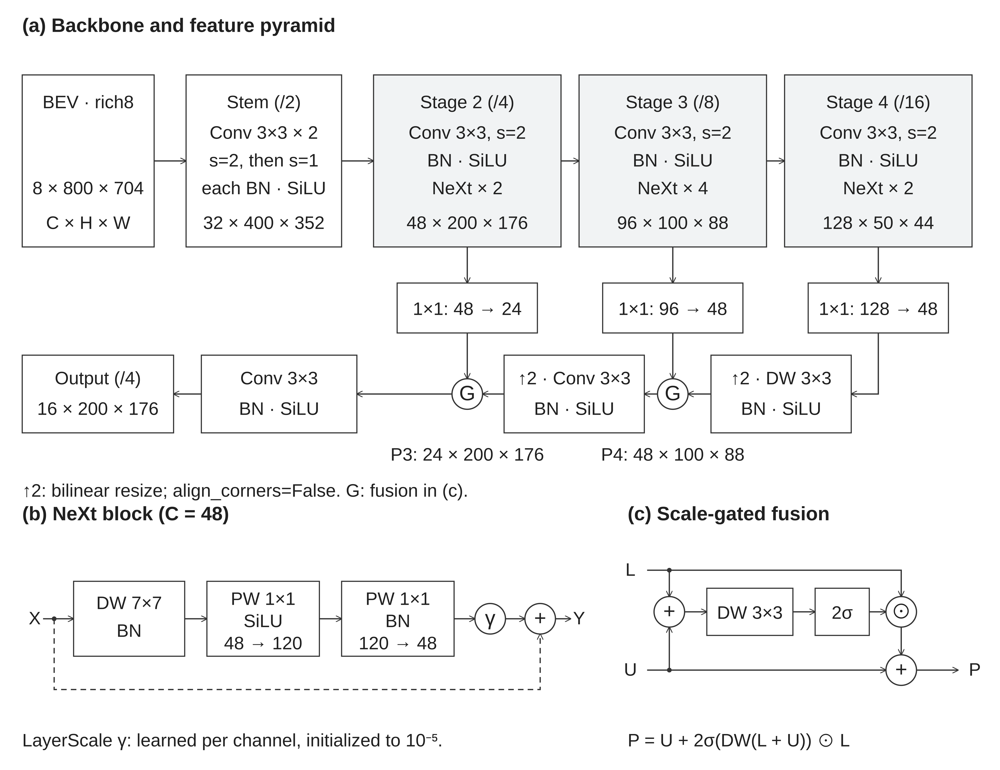

# MobilePixorNeXt — paper figure (2D)



Bản ngang hai cột, nền trắng, xám nhạt, nhãn tiếng Anh, chữ Arial-compatible khoảng
9.3 pt khi đặt đúng khổ 182 mm. Đường nối thể hiện dữ liệu; vòng tròn là phép cộng,
nhân từng phần tử hoặc LayerScale. Ba panel:

- **(a)** Backbone và FPN: BEV rich8 → stem hai convolution → stages 2/3/4 với
  2/4/2 NeXt blocks → lateral projections → gated fusion → output stride 4.
- **(b)** Block ở 48 kênh: DW 7×7 + BN → PW expand 48→120 + SiLU → PW project
  120→48 + BN → LayerScale → cộng residual.
- **(c)** Gate: `P = U + 2σ(DW(L + U)) ⊙ L`; DW gate được khởi tạo zero nên gate
  ban đầu bằng 1. `L` là lateral feature, `U` là feature sau upsampling/refinement.

| Mục đích | File |
|---|---|
| Đưa vào LaTeX/Word, giữ nét vector | [backbone.pdf](backbone.pdf) |
| Chỉnh nhãn/bố cục trong Inkscape/Illustrator | [backbone.svg](backbone.svg) |
| Xem trước hoặc nơi yêu cầu raster, 600 dpi | [backbone.png](backbone.png) |
| Caption tiếng Anh và môi trường `figure*` | [caption.tex](caption.tex) |
| Topology và kích thước tensor | [architecture.json](architecture.json) |
| Config/code/renderer SHA-256 để tái tạo | [provenance.json](provenance.json) |

Hình được sinh bằng SVG từ code và config, không dùng ảnh raster sinh bằng AI.
Thiết kế tham khảo [hướng dẫn hình của IEEE](https://proceedingsoftheieee.ieee.org/resources/guidelines-for-figures-and-tables/):
ít màu, chữ nhất quán, nhãn gọn và nét rõ. Khổ/cỡ chữ cần đối chiếu template của nơi
nộp bài; thu hình nhỏ hơn sẽ làm chữ nhỏ theo. PDF hiện tại nhúng Arimo và Nimbus
Sans cho các ký tự toán; không chứa ảnh bitmap.

Nguồn mặc định là `configs/config.json`, output `16 × 200 × 176`, chưa có
FocalContext/ECA/detail path. Shape được suy từ resolver và code; không chạy
forward PyTorch trong môi trường xuất hình này. Detection heads nằm ngoài hình.
Caption này viết cho config mặc định; sửa caption nếu xuất một experiment khác.

```bash
python3 tools/visualization/export_paper_figure.py --details
```

Lệnh cần Python, Node.js và `rsvg-convert` (librsvg); không cần GPU hay PyTorch.
`--dpi` chỉ ảnh hưởng PNG, mặc định 600. Dùng `--config` và `--output-dir` để xuất
run khác vào một thư mục riêng.

Các view 2D mở rộng ở [details/](details/), gồm stem, từng stage/block, U4/U3,
gate4/gate3 và output projection. Chúng giữ từng primitive operation nên có thể
rộng hơn bố cục ba panel; cần chia panel/chỉnh bố cục trước khi đưa vào bài.

Mở [Backbone.html](../../tools/visualization/nn_svg/Backbone.html), chọn **Paper 2D**
hoặc **Tensor 3D**. Xem thêm [hướng dẫn NN-SVG](../../tools/visualization/nn_svg/README.md).
