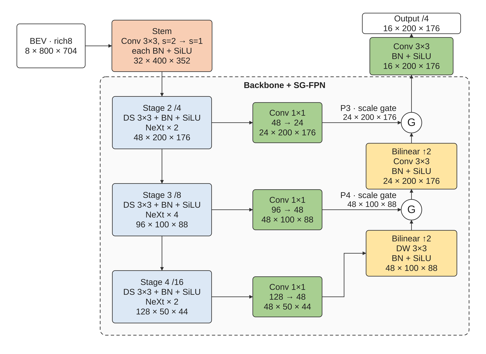

# Reference-style backbone diagram



Bản này dựa trên bố cục/màu/khung nhóm của `diagrams/other_paper.png` và
`other_paper_backbone.png`: encoder dọc, FPN đi lên, block màu pastel, đường
nối vuông góc và nhóm nét đứt. Source model là `configs/config.json`, với bilinear
upsampling/refinement và scale gate. Nhãn DS là downsampling, /4,/8,/16 là stride.
Kích thước là C × H × W, batch omitted. Detection heads nằm ngoài hình.

- [PDF vector](backbone.pdf) để đưa vào bài báo.
- [SVG chỉnh sửa được](backbone.svg) và [PNG 600 dpi](backbone.png).
- [JSON đầy đủ để nạp vào editor](backbone.editor.json).
- [Provenance và SHA-256](provenance.json) để kiểm tra nguồn và tái tạo.
- [Các view chi tiết](details/) cho stem, stages/blocks, FPN gate và refinements.

Mở [Backbone.html](../../tools/visualization/nn_svg/Backbone.html), mặc định kiểu
**2D · màu theo hình mẫu**. Chọn block để sửa nhãn/shape/màu; bật **Kéo / resize**
để thay bố cục; **Nối block** để thêm nhánh. Có nhân bản/xóa, group, Undo/Redo,
bản vẽ mới và lưu/nạp JSON. Renderer vẽ dữ liệu bất kỳ, không cố định các block
hoặc các tọa độ theo model. Xem [hướng dẫn](../../tools/visualization/nn_svg/README.md).

```bash
python3 tools/visualization/export_reference_figure.py

python3 tools/visualization/export_reference_figure.py \
  --document backbone-custom.json --output-dir artifacts/diagrams/custom
```

Cần Python, Node.js và `rsvg-convert`; không cần GPU hay PyTorch. PDF hiện tại
nhúng Arimo, không chứa bitmap. Main figure rộng 182 mm, chữ body khoảng 9 pt;
đối chiếu kích thước với template nơi nộp bài. Các view chi tiết rộng cần chỉnh
bố cục/chia panel trước khi thu nhỏ đưa vào bài.

Bản vẽ custom không tự suy ra shape kế tiếp hoặc thay đổi config huấn luyện.
Shape nguồn mặc định được suy từ config và code; môi trường xuất này không chạy
forward PyTorch. Các bản [3D](../nn_svg/README.md) và [2D composite cũ](../paper_2d/README.md)
được giữ riêng.
