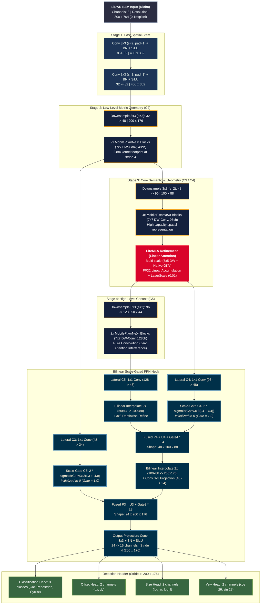
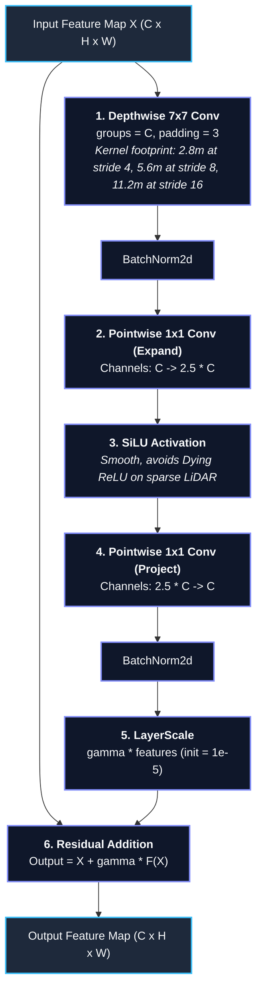

# MobilePixorNeXt Architecture Specification & Diagrams

## Current attention placement (2026-10-14)

MobilePixorNeXt supports one Focal Context and one local adapter (SimAM or ECA),
each independently placed after C3/C4/C5. The feature level and Python stage are:

| Feature | Python stage | Channels | Stride |
|---|---|---:|---:|
| C3 | stage2 | 48 | 4 |
| C4 | stage3 | 96 | 8 |
| C5 | stage4 | 128 | 16 |

Choose `model.focal_stage` and `model.local_attention_stage` as `c3`, `c4` or
`c5`. Defaults preserve historical Focal C4/local C3 placement. When both active
modules occupy one stage, `model.attention_order` selects `focal_then_local`
(default) or `local_then_focal`. The second module receives the first module's
output. Refined features feed both the next downsample and the matching FPN
lateral; refined C5 feeds the neck's deepest input.

The registered names `c4_context` and `c3_light_attention` are historical
checkpoint prefixes, independent of the execution stage. Focal changes its
input/output channels to match the selected stage. Core module formulas and
neck/head topology are unchanged. State-free `attention_c3_output`,
`attention_c4_output`, `attention_c5_output` taps expose the final refined stages.

Use the Standard/Robust notebook controls `FOCAL_STAGE`,
`LOCAL_ATTENTION_STAGE`, `ATTENTION_ORDER` with `PRESET="custom"`. Module selectors
remain `C4_CONTEXT` and `LOCAL_ATTENTION`. Config/preset modes ignore custom stage
controls. No experiment config files are generated; each run still saves its own
resolved snapshot. Changing active placement/order requires a new training run.

For a current diagram use `tools/visualization/export_backbone_diagram.py` with
the run's saved config. See [the stage-selection spec](superpowers/specs/2026-10-14-stage-selectable-attention-design.md).

## 1. Historical Rich8/LiteMLA pipeline diagram

The diagram and numbered historical notes below describe an earlier design.
LiteMLA is retired in the current runtime; `c4_attention` accepts only `none`.
The fixed attention placement below is superseded by the current contract above.

---

## 2. Micro-Architecture: `MobilePixorNeXtBlock` Detail

