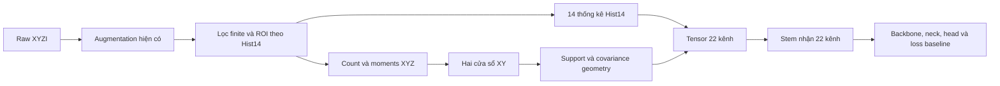

# Hist22: BEV bổ sung hình học đa tỉ lệ lấy cảm hứng từ CANUPO

Ngày: 17/10/2026. Branch: `feature/canupo-inspired-bev22`.

Trạng thái: bản đặc tả thiết kế cho **hướng 1 — bổ sung feature vào input BEV**, theo quyết định thử thẳng 22 kênh. Tài liệu này chốt thiết kế và cách nghiệm thu; chưa kết luận Hist22 làm tăng Detection AP.

Quyết định chính: **một cặp ablation Hist14 ↔ Hist22**, train từ đầu với khởi tạo ghép cặp, giữ nguyên cấu hình mô hình/loss/attention và protocol. Thông tin bổ sung được tính từ point cloud sau augmentation, tại hai scale cố định. Chi phí encoding, toàn pipeline và bộ nhớ là một phần của đánh giá.

### Goal

- Thử đúng **một candidate `hist22`** trong detector: Hist14 hiện tại cộng 8 kênh lân cận/hình học. Cặp ablation chính là **Hist14 baseline ↔ Hist22**.
- Kiểm tra liệu thông tin hình học bổ sung có cải thiện detection AP với mức tăng latency/bộ nhớ chấp nhận được hay không. Không xem Point AP của probe là bằng chứng detector đã cải thiện.
- Giả thuyết cần kiểm chứng: hai scale giúp detector phân biệt các pillar có thống kê chiều cao/mật độ giống nhau nhưng cách phân bố XYZ khác nhau. Lợi ích theo lớp và khoảng cách phải được đo, chưa được giả định từ map trực quan.

### Constraints

- Không thêm encoder, preset hoặc run huấn luyện `hist18`. Kết quả Hist18 trong phân tích trước được giữ như tài liệu lịch sử.
- Không thêm head phụ, geometry loss, attention hoặc geometry gate. Backbone/neck/head/loss giữ theo baseline đã đóng băng, ngoài thay đổi bắt buộc số kênh vào convolution đầu tiên.
- Không lọc cứng điểm theo dimensionality; không dùng GT, nhãn semantic hoặc confidence classifier CANUPO để tạo input.
- `hist22` là lựa chọn chủ động; không đổi default hoặc semantics của `rich8`, `hist14`, binary slices và các pillar encoder.
- Phạm vi đầu tiên: MobilePixorNeXt, PyTorch train/evaluate, cùng geometry KITTI 0,1 m. Tối ưu backend dựa trên benchmark nhưng phải giữ parity số học.

### Known context

- Runtime Hist14 và contract của nó nằm ở [bev_encoding.py](../../../detector/core/bev_encoding.py), [bev_backend.py](../../../detector/core/datasets/utils_1/bev_backend.py); [Dataset.encode_input](../../../detector/core/datasets/dataset.py) được gọi sau augmentation.
- Prototype [bev_geometry_maps.py](../../../tools/analysis/bev_geometry_maps.py) và [visualization](../../../tools/visualization/compare_bev_geometry_maps.py) đã tạo được tensor 22 kênh. Đây là nguồn đối chiếu số học, chưa phải runtime encoder.
- [Phân tích đã kiểm chứng](../../bev_geometry_visualization_vi.md): probe trên đúng các kênh BEV đạt point AP 66,96% với Hist14 và 76,84% với Hist22, trên 48 frame validation ngẫu nhiên/196.608 core. Không có detector retrain tương ứng.
- Prototype CPU có p50 khoảng 101,71 ms/frame cho đường tính 22 kênh; chưa gồm I/O, transfer hoặc detector. Không dùng số này để cam kết latency của implementation mới.
- Notebook hiện tại mặc định `BOX_MODE="bev"`, `BEV_ENCODING="hist14"`. Các lựa chọn head/loss/Focal/block SimAM đang độc lập với encoder và phải giữ nguyên khi đổi encoding.

### Risks

- Các dải quét LiDAR có thể trông giống đường 1D ở cửa sổ nhỏ; đủ 6 điểm không bảo đảm geometry chính xác hoặc thuộc cùng đối tượng.
- Cửa sổ XY gom toàn chiều cao ROI, có thể trộn đường/xe/vật thể gần nhau. Không được gọi đây là CANUPO quả cầu 3D tương đương.
- Float32 ở bước ROI/index có thể tạo lệch ô sát biên so với Hist14. Toàn nhánh Hist22 phải khớp quy tắc float64 của Hist14.
- Input 22 kênh tăng RAM, transfer và MAC ở stem; số parameter tăng nhỏ không đồng nghĩa overhead nhỏ.
- Cùng seed nhưng convolution đầu có shape khác có thể làm lệch khởi tạo các layer sau và RNG augmentation. Cần khởi tạo ghép cặp và RNG data riêng.
- Một seed chỉ cho kết quả thử ban đầu; AP tăng không tự chứng minh độ bền giữa nhiều seed/dataset.

### Options

1. **Runtime encoder Hist22 từ pooled moments — chọn cho v1.** Dùng thuật toán đã visualization để tạo tensor 22 kênh sau augmentation. Có nguồn đối chiếu và thay đổi tập trung vào input; nhược điểm là CPU/memory cần đo và tối ưu. Độ phức tạp trung bình, rủi ro chính ở tính đúng số học và tốc độ tiền xử lý.
2. Đưa descriptor CANUPO gốc vào runtime. Gần thuật toán gốc hơn nhưng chi phí và phụ thuộc binary không phù hợp với hướng detector nhẹ đã chọn. Độ phức tạp cao, rủi ro latency lớn; ngoài phạm vi v1.
3. Dùng teacher/auxiliary loss hoặc geometry gate. Có thể nghiên cứu sau nhưng làm thay đổi cách học/fusion. Độ phức tạp và rủi ro gây nhiễu phép so sánh cao hơn phương án 1; ngoài phạm vi v1.

### Recommendation

Đăng ký encoder mới **`hist22`, version 1, đúng 22 kênh**. Giữ nguyên 14 kênh Hist14 và nối thêm 4 kênh support + 4 kênh dimensionality. NumPy là reference; Numba là backend tối ưu được chọn tường minh như Hist14. Không âm thầm thay backend hoặc dùng prototype phân tích trong DataLoader.

| Nhóm | Số kênh | Thông tin bổ sung |
|---|---:|---|
| Hist14 hiện tại | 14 | Thống kê trong từng pillar, giữ nguyên semantics |
| Support tại hai scale | 4 | Mỗi scale: log số điểm lân cận và cờ geometry hợp lệ |
| Dimensionality tại hai scale | 4 | Mỗi scale: hệ số dạng đường và dạng mặt; dạng khối suy ra được khi valid |

Tính “an toàn” của hướng này nằm ở phạm vi thay đổi tập trung vào input và khả năng quay lại Hist14. Việc thêm feature vẫn có thể làm AP giảm hoặc latency tăng; ablation quyết định có giữ Hist22 hay không.

## 1. Luồng dữ liệu và phạm vi điểm



- Train: tính trên point cloud **sau toàn bộ** GT sampling, point removal, flip, rotation, scaling và translation.
- Validation/test: tính từ scene đầu vào với cùng contract; không cần GT để encode.
- Dùng chính các điểm trong ROI Hist14, không mở thêm context ngoài ROI, không camera-FOV filtering mới, không downsample/cap số điểm.
- Chỉ giữ điểm finite ở bốn cột XYZI. Chuyển bốn cột sang float64 **trước** kiểm tra ROI và tính index.
- Biên mở: `axis_min + 0.001 < coordinate < axis_max - 0.001`. Index XY: `floor((coordinate - axis_min) / resolution)` bằng float64.
- Geometry hiện tại (đơn vị m): `x_min=0.0, x_max=70.4`, `y_min=-40.0, y_max=40.0`, `z_min=-2.5, z_max=1.0`; độ phân giải x/y 0,1 m. Áp dụng biên mở có epsilon như trên. Số ô W=704 theo x, H=800 theo y.
- V1 yêu cầu `x_res=y_res=0.1`; geometry khác độ phân giải phải bị từ chối rõ ràng, không âm thầm đổi nghĩa kích thước cửa sổ.
- Tọa độ và feature dùng cùng quy tắc trên CPU train/evaluator; không tái sử dụng cách float32 floor-division của Rich8 cho Hist22.

## 2. Contract tensor và các kênh

Output encoder CPU là float32, độc lập sở hữu bộ nhớ, contiguous CHW `[22,H,W]`. Batch vào model là `[B,22,H,W]`. Nếu có API HWC để tương thích tooling, phải khai báo rõ `[H,W,22]` và không làm Dataset tạo thêm một bản dense HWC không cần thiết.

| Index | Tên | Quy tắc |
|---:|---|---|
| 0–3 | `height_count_b0` … `height_count_b3` | Giữ nguyên height bins và normalization Hist14 |
| 4 | `z_max` | Giữ nguyên Hist14 |
| 5 | `z_mean` | Giữ nguyên Hist14 |
| 6 | `z_span` | Giữ nguyên Hist14 |
| 7 | `z_std` | Giữ nguyên Hist14 |
| 8 | `intensity_max` | Giữ nguyên Hist14 và intensity options |
| 9 | `intensity_mean` | Giữ nguyên Hist14 và intensity options |
| 10 | `log_density` | Giữ nguyên Hist14 và density options |
| 11 | `occupancy` | Giữ nguyên Hist14 |
| 12 | `point_offset_x` | Giữ nguyên Hist14 |
| 13 | `point_offset_y` | Giữ nguyên Hist14 |
| 14 | `neighbor_log_count_1m` | `log1p(N_small)`, không chia density_norm, không clip |
| 15 | `geometry_valid_1m` | 0 hoặc 1 theo điều kiện đủ điểm và variance |
| 16 | `neighbor_log_count_2m` | `log1p(N_large)`, không chia density_norm, không clip |
| 17 | `geometry_valid_2m` | 0 hoặc 1 ở cửa sổ lớn |
| 18 | `dimensionality_1d_1m` | a ở cửa sổ nhỏ |
| 19 | `dimensionality_2d_1m` | b ở cửa sổ nhỏ |
| 20 | `dimensionality_1d_2m` | a ở cửa sổ lớn |
| 21 | `dimensionality_2d_2m` | b ở cửa sổ lớn |

- Với backend NumPy, `hist22[:14]` phải khớp bitwise với **Hist14 NumPy reference** trên cùng điểm/options. Với backend Numba, dùng tolerance đã kiểm chứng của Hist14 (`atol=1e-6, rtol=1e-5`), không tuyên bố bitwise nếu arithmetic khác; hình học đối chiếu thêm brute-force/eigvalsh.
- Ô trống của Hist14: toàn bộ 22 kênh bằng zero, dù xung quanh có điểm. Không spread/dilate feature vào ô trống.
- Có điểm nhưng geometry invalid: vẫn giữ 14 kênh cũ và log-count thực; valid=0, a=b=0 ở scale đó.
- Không thêm kênh c: khi valid, `c=1−a−b` suy ra được. Khi invalid, không diễn giải a=b=0 thành c=1.
- `geometry_valid` là cờ số học, không phải confidence đã hiệu chuẩn hoặc dự đoán foreground.

## 3. Lân cận, moments và dimensionality

Giữ đúng semantics của prototype đã đánh giá:

| Scale danh nghĩa | Số ô XY | Bán kính ô | Bề rộng thực tại 0,1 m |
|---|---:|---:|---:|
| 1 m | 11×11 | 5 ô mỗi phía | 1,1×1,1 m |
| 2 m | 21×21 | 10 ô mỗi phía | 2,1×2,1 m |

Lân cận của pillar (iy,ix) là toàn bộ điểm nằm trong các ô thuộc cửa sổ, giữ toàn chiều cao ROI. Cửa sổ được clip tại biên; phần ngoài ROI không được thêm điểm phản chiếu hoặc wrap. Chỉ tính geometry tại các ô occupied của Hist14.

Tích lũy 10 thống kê bằng float64: `N, Σx, Σy, Σz, Σx², Σxy, Σxz, Σy², Σyz, Σz²`. Trừ một mốc giữa ROI khỏi XYZ trước khi tích lũy để giảm cancellation; không đổi nghĩa covariance. Gộp bằng summed-area tables hoặc thuật toán được kiểm chứng tương đương.

Covariance population: `C = Σ(ppᵀ)/N − μμᵀ`. Giữ đối xứng; dùng eigenvalues giảm dần λ1≥λ2≥λ3 và clip số âm do roundoff về 0. Đặt `T=λ1+λ2+λ3`.

```text
valid = (N >= 6) and (T > 1e-12)
a = (λ1 − λ2) / T
b = 2(λ2 − λ3) / T
c = 3λ3 / T
```

Clip a,b,c vào [0,1] để xử lý roundoff. Invalid thì a=b=c=0. Eigenvalues không finite hoặc eigensolver lỗi không được âm thầm biến thành một tensor hợp lệ; báo lỗi rõ để điều tra. Các điểm input NaN/Inf được loại theo contract Hist14 trước đó.

V1 cố định hai cửa sổ, `min_neighbors=6` và trace epsilon; chưa mở knobs để thay đổi trong từng run. Nếu sau này thay nghĩa feature, phải có schema/version và thí nghiệm mới.

## 4. Config và semantic identity

Ví dụ cấu hình runtime v1 với backend tối ưu được chọn tường minh; `numpy` vẫn là reference/default khi bỏ backend:

```json
{
  "name": "hist22",
  "version": 1,
  "out_channels": 22,
  "backend": "numba",
  "density_norm": 32.0,
  "intensity_scale": 1.0
}
```

- `out_channels` bỏ trống thì resolve 22; khai báo khác 22, kiểu bool/float, version khác 1 hoặc option không biết phải fail rõ.
- Backend v1 gồm `numpy` và `numba`; không được tự fallback khi thiếu Numba hoặc request backend không hỗ trợ. Resolver điền NumPy khi chưa khai báo; notebook chọn Numba tường minh và phải in backend hiệu lực. JIT không dùng fastmath làm thay đổi ROI/geometry.
- `density_norm` và `intensity_scale` chỉ điều khiển phần Hist14 như hiện tại; không đổi raw `log1p(N)` của kênh 14/16.
- Semantic metadata/hash phải chứa toàn bộ channel order, geometry, ROI/index/precision policy, population covariance, windows [11,21], bề rộng thực, min_neighbors, epsilon, eigenvalue clipping, empty/invalid policy và base Hist14 semantics.
- Backend tiếp tục là provenance riêng theo hệ thống hiện tại. Một backend tối ưu về sau chỉ được dùng cùng semantic identity khi chứng minh cùng semantics và parity số học.
- Hist14 legacy phải giữ nguyên semantic hash, defaults, checkpoint identity và behavior khi Hist22 không bật.
- Gọi biểu diễn này là CANUPO-inspired Hist22; không đổi tên thành CANUPO chuẩn hoặc thêm alias `rich14`/`hist18` vào runtime.

## 5. Model và khởi tạo ghép cặp

Model nhận số kênh từ schema; không hardcode 22 rải rác hoặc dùng một adapter/attention mới. Stem hiện tại đổi convolution đầu từ 14→32 thành 22→32; phần còn lại giữ nguyên.

Để giảm nhiễu của ablation:

1. Tạo state baseline **chưa train** với seed của cặp chạy, lưu hash/state khởi tạo.
2. Candidate nhận cùng giá trị cho mọi tensor chung, bao gồm BN; 14 lát input đầu của stem copy từ baseline.
3. Tám lát input mới của stem khởi tạo zero. Chúng vẫn train bình thường, không freeze.
4. Reset/dùng generator riêng cho sampler, DataLoader và augmentation sau khởi tạo; construction của candidate không được làm thay đổi thứ tự dữ liệu hoặc RNG augmentation của cặp.
5. Kiểm tra output ban đầu giữa baseline và candidate trên cùng point cloud trong eval FP32 khớp trong tolerance số học đã khai báo. Không yêu cầu bitwise output giữa các CUDA kernel khác shape.

Đây là khởi tạo từ state random chưa train, không phải resume hoặc fine-tune một checkpoint Hist14 đã học. Phần stem mới phải nhận gradient hữu hạn khác zero trong một optimizer step có feature mới hợp lệ.

Với stem Conv3×3, stride2, 32 output channels hiện tại: tăng **2.304 parameter**. Trên grid 800×704, riêng phần convolution thêm khoảng **0,324 GMAC/frame**. Phải đo tổng model thực tế; không suy ra latency từ số parameter.

## 6. Dataset, notebook, checkpoint và deployment

- Dataset thêm nhánh CHW cho `hist22` sau augmentation; không gọi tooling phân tích vốn tạo cả Rich8/Hist18 và nhiều tensor trung gian không phục vụ train.
- Train và PyTorch evaluators dùng cùng runtime encoder. Cache scene trước GT sampling/scaling không hợp lệ cho geometry sau augmentation.
- Không thay đổi master config mặc định. Hai notebook cho phép `BEV_ENCODING="hist22"`, resolve 22 kênh/backend đang chọn, và hiển thị rõ cửa sổ cùng schema hash.
- Khi đổi encoding, notebook phải dựng encoding dictionary mới hoặc dọn option không áp dụng; không giữ ngầm backend NumPy/Numba hoặc `out_channels=14` từ lần chọn trước.
- Không dùng preset encoder có tác dụng phụ đổi backbone/head/loss. Đổi Hist14↔Hist22 chỉ đổi encoding, run identity và khởi tạo stem tương ứng.
- Hist14 và Hist22 có run name/directory khác, config snapshot và checkpoint identity khác. Resume/evaluate chéo hai schema phải bị từ chối, kể cả khi bỏ qua lỗi shape bằng một cách load thủ công.
- Sau paired initialization, resume chỉ nhận checkpoint Hist22 cùng schema và training identity. Không có implicit stem padding/slicing khi nạp checkpoint.
- ONNX/TensorRT không phải điều kiện hoàn thành v1 train/evaluate. Giữ các guard hiện tại cho grouped/IQA/3D; không hạ cấu hình để export và không bỏ output. Model graph nhận 22 kênh không có nghĩa toàn pipeline deployment đã hỗ trợ tiền xử lý Hist22; consumer chưa được nối đúng encoder phải từ chối rõ.

## 7. Một cặp ablation duy nhất

| Run | Encoder | Khởi tạo | Các mục còn lại |
|---|---|---|---|
| A: `hist14_base_s42` | Hist14 14ch | Paired random baseline | Baseline đã resolve và đóng băng |
| B: `hist22_geom_s42` | Hist22 22ch | Copy phần chung từ A ở T0, zero 8 lát mới | Giống A |

Tên thực tế phải có fingerprint của cấu hình để không ghi đè run cũ. Không tạo run Hist18, geometry-only hoặc thay đổi attention trong đợt này.

**Baseline nguồn:** cấu hình người dùng đang chọn, đã resolve từ notebook/CLI và được lưu thành snapshot trước train. Không lấy một preset lịch sử khác làm baseline nếu nó thay head/Focal/block SimAM/loss. Run B được tạo từ snapshot A bằng thay thế riêng `data.bev_encoding` và metadata experiment; danh sách diff được lưu và kiểm tra trước khi train.

Cùng seed 42 và train từ đầu; budget epoch/warmup lấy từ snapshot baseline cho cả hai run. Master config và notebook Robust hiện mặc định 50 epoch/warmup 4; nếu snapshot người dùng đang chọn có budget khác thì giữ đúng budget đó, không tự chuyển sang recipe 100/8 của experiment lịch sử. Hai run dùng cùng optimizer/LR/scheduler/batch/precision/augmentation và cùng lịch AP selection. Các giá trị chung phải xuất hiện trong hai resolved config, không chỉ trong tên run. Không chạy thêm một budget khác rồi chọn kết quả đẹp hơn.

Box mode mặc định giữ **BEV như notebook hiện tại**. Primary metric là local loader-aligned rotated BEV AP R40 Moderate mAP của cùng evaluator/split, cùng decode/NMS/thresholds và checkpoint selector. Không đổi sang 3D trong một nhánh. Nếu baseline nguồn đã chọn 3D trước khi bắt đầu cặp, đóng băng 3D cho cả hai, dùng cùng reference 3D selector và báo cáo BEV/3D tương ứng; đó vẫn là một cặp theo một protocol, không phải trộn hai loại run.

Split hiện tại 3.712 train / 3.769 validation; GT database chỉ từ train IDs. Các frame visualization có thể xem toàn cảnh, nhưng không đưa validation labels vào encoding, normalization hoặc feature construction. Không dùng Point AP để chọn checkpoint detector.

Báo cáo tối thiểu: AP Car/Pedestrian/Cyclist, Easy/Moderate/Hard, Moderate mAP và Δ(B−A); cùng epoch/checkpoint-selection protocol, parameter/MAC, train throughput, peak RAM/VRAM và latency theo stage. Nếu có 3D, báo cáo thêm vertical error trong cùng định nghĩa diagnostic. Một seed được gọi là kết quả ban đầu; lặp seed sau nếu cần không tạo thêm một encoder ablation.

Không được tự giảm batch, giảm worker ảnh hưởng protocol hoặc đổi precision riêng cho candidate để tránh OOM rồi xem là cặp tương đương. Nếu phải thay batch/budget, áp dụng và ghi lại cho cả hai run trước khi so sánh.

## 8. Benchmark và mức hoàn thành

- **Mốc S — đặc tả:** chốt channel order, lân cận, quy tắc số học, initialization, protocol và tiêu chí kiểm chứng trong tài liệu này. Hoàn thành spec chưa đồng nghĩa đã triển khai hoặc đã có kết quả huấn luyện.
- **Mốc I — runtime:** encoder và tích hợp vượt các kiểm tra tính đúng, forward/backward/restore thật, notebook/config hoạt động, có benchmark CPU/GPU đúng phạm vi thiết bị đã đo. AP của ablation có thể còn pending ở mốc này.
- **Mốc E — thí nghiệm:** cả hai run hoàn thành cùng budget và được đánh giá bằng cùng selector/evaluator; có bảng AP và chi phí để quyết định giữ hay bỏ Hist22. Chỉ mốc này cho phép kết luận về Detection AP.
- Functional smoke: scene rỗng/thưa/dày, một batch forward/backward/optimizer thật, restore checkpoint Hist22; chưa dùng smoke AP để kết luận.
- Đo encoding p50/p95 trên cùng frame list và CPU/thread count; tách I/O, ROI/Hist14, support/geometry, transfer, forward và decode/NMS. Với GPU, đồng bộ đúng tại ranh giới đo.
- Đo inference batch1 trên cùng thiết bị/precision; tổng thời gian phải bao gồm encode 22 kênh. Báo cả throughput train để thấy tác động DataLoader.
- Đo peak memory theo số worker/prefetch thực tế; scratch moments float64 không được bỏ khỏi báo cáo. Dense input FP32 tăng từ khoảng 30,08 lên 47,27 MiB/frame (+57,1%).
- V1 không đặt cam kết realtime hoặc một mức tăng AP tối thiểu chưa có bằng chứng. Tách kết luận **implementation đúng** với **ablation cải thiện AP/chi phí**. Nếu AP không tăng hoặc latency quá cao, báo đúng kết quả thay vì đổi feature rồi giữ nguyên tên experiment.

Mẫu báo cáo mốc E; các ô chưa đo giữ `pending`:

| Chỉ số, cùng điều kiện đo | Hist14 | Hist22 | Chênh lệch B−A / tỷ lệ |
|---|---|---|---|
| BEV AP R40 Moderate: Car / Pedestrian / Cyclist | pending | pending | pending |
| BEV Moderate mAP | pending | pending | pending |
| Encoding p50 / p95, ms/frame | pending | pending | pending |
| Tổng inference p50 / p95, ms/frame | pending | pending | pending |
| Train throughput, sample/s | pending | pending | pending |
| Peak RAM / VRAM với worker và prefetch đã ghi | pending | pending | pending |

AP tăng ở một seed là tín hiệu ban đầu. Nếu mAP tăng nhưng một lớp giảm hoặc chi phí tăng đáng kể, trình bày đầy đủ trade-off trước khi chọn làm default. Hist14 tiếp tục là baseline để đối chiếu.

## 9. Điểm tích hợp dự kiến

| Thành phần | Tệp | Trách nhiệm |
|---|---|---|
| Schema | `detector/core/bev_encoding.py` | Resolve Hist22, channel names, metadata và identity |
| Encoder mới | `detector/core/datasets/utils_1/hist22_backend.py` | Runtime NumPy/Numba CHW, moments và geometry |
| Dispatch | `detector/core/datasets/utils_1/preprocess.py`, `dataset.py` | Encode đúng sau augmentation |
| Model/pipeline | `detector/core/models/model.py`, `tools/kitti_training_pipeline/common.py`, `train.py` | Input width, validation, checkpoint và paired-init |
| Notebook | `notebook_config.py`, `notebook_workflow.py`, hai notebook và `tools/generate_robust_notebook.py` | Chọn encoding, resolve config, in tóm tắt |
| Evaluation/benchmark | `evaluate_kitti_bev.py`, `evaluate_kitti_3d.py`, `tools/benchmarks/benchmark_bev_encodings.py` | Dùng chung encoder, đo đúng pipeline |
| Verification | `tests/test_hist22_encoding.py`, schema/dataset/model/checkpoint/notebook tests | Các điều kiện dưới đây |

Các đường trong bảng tính từ `Code/`. Bảng là phạm vi tích hợp dự kiến, không yêu cầu sửa tệp nếu contract hiện tại đã xử lý đúng. Giữ nguyên các thay đổi người dùng đang làm ở train/evaluator/postprocess.

### Acceptance criteria

- Có đúng một encoding runtime mới `hist22` 22ch; không thêm lựa chọn 18ch. Hist14/default/legacy identities không đổi.
- Trên cùng dữ liệu/options, NumPy giữ 14 kênh đầu khớp Hist14 NumPy bitwise, Numba trong tolerance đã nêu; toàn output có đúng shape/layout, float32 contiguous và finite.
- ROI/index/mask nhất quán float64, có regression cho tọa độ sát biên ROI/ô; Rich8 legacy không bị sửa semantics để ép parity.
- Window count/covariance/dimensionality khớp brute-force trên dữ liệu nhỏ; có line/plane/volume, empty, singleton, duplicate/degenerate, sparse, nonfinite và border-clipped cases.
- Valid mask, invalid geometry zero, raw log-count và empty-cell zero đúng. Không tạo dense feature ở ô trống.
- Runtime khớp prototype 22ch đã kiểm chứng: count/mask chính xác, a/b trong `atol=2e-6, rtol=1e-5`; mọi sai khác lớn hơn tolerance phải được giải thích trước khi train. Đối chiếu thêm covariance/eigenvalues tính trực tiếp để tránh hai implementation cùng mắc một lỗi.
- GT sampling/scaling/point removal làm encoder tính lại từ đúng điểm sau augmentation; không dùng cached geometry sai scene.
- Full-size KITTI input và một optimizer step thật qua được; 8 lát stem mới học được, output khởi tạo có parity với baseline trong FP32 tolerance.
- Mọi layer chung được khởi tạo giống nhau; RNG data/sampler độc lập với khác biệt shape stem; lưu paired-init provenance.
- Resume/evaluate sai schema/version bị chặn; checkpoint cũ Hist14 tiếp tục hoạt động như trước.
- Notebook chọn Hist22 không đổi model/loss/attention và không giữ lại channel/backend option sai; run/config/hash tách biệt.
- Hai resolved config chỉ khác encoding/experiment metadata và chi tiết init bắt buộc; cùng split, seed, augmentation, budget, selector và evaluator.
- Mốc I có report kiểm chứng và benchmark; mốc E có report detection AP và latency/memory của cặp. Point AP cũ chỉ là motivation, không được trình bày như detector AP.

## 10. Ngoài phạm vi và rollback

Không triển khai hướng 2/3, không đổi loss/head/attention, không nghiên cứu lại bộ scale, không thêm pretrained transfer scheme và không chạy benchmark dataset khác trong v1. Không yêu cầu full deployment mới để hoàn thành PyTorch ablation.

Rollback bằng cách chọn lại encoding `hist14` và run/checkpoint Hist14 tương ứng. Không chuyển một checkpoint Hist22 thành Hist14 bằng cắt stem, và không ghi đè artifact của cặp chạy.
