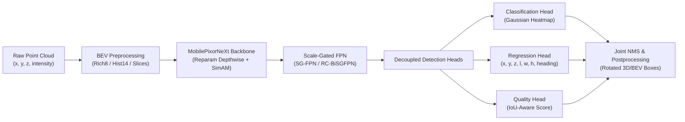

# LiDAR BEV 3D Object Detection: MobilePixorNeXt

<div align="center">

[](https://www.python.org/)
[](https://pytorch.org/)
[](https://developer.nvidia.com/cuda-toolkit)
[](https://github.com/danhyoyo/Lidar/actions/workflows/ci.yml)
[](LICENSE)
[](https://cantho.fpt.edu.vn/)

**Ultra-Lightweight (<1M Parameters), Real-Time Bird's-Eye View (BEV) 3D LiDAR Object Detection for Autonomous Driving and Robotics**

*Developed at FPT University Can Tho Campus (Trường Đại học FPT Cần Thơ)*

[Overview](#-overview) •
[Key Innovations](#-key-innovations) •
[Architecture](#-system-architecture) •
[Quickstart](#-quickstart--installation) •
[KITTI Pipeline](#-kitti-dataset-pipeline) •
[Training](#-training) •
[Evaluation](#-evaluation) •
[Deployment](#-deployment--tensorrt) •
[Contributing](#-contributing) •
[License](#-license)

</div>

---

## 🌟 Overview

This repository provides an end-to-end framework for high-precision, real-time 3D object detection from LiDAR point clouds using 2D Bird's-Eye View (BEV) representations. Centered around **MobilePixorNeXt** and **MobilePIXOR**, this project pushes the boundaries of edge-compute efficiency:

- **Ultra-Compact Footprint**: Backbones engineered with fewer than **1 Million parameters**, making high-rate 3D inference feasible on resource-constrained embedded platforms (e.g., NVIDIA Jetson, edge robotic computers).
- **Structural Reparameterization**: Multi-branch training topologies (3×3 depthwise + 1×1 depthwise + identity) collapsed into a single equivalent 7×7 depthwise convolution at deployment via `--deploy`, achieving zero architectural overhead during inference.
- **Unified Master Configuration**: Seamless ablation studies, loss scheduling, and augmentation recipes managed centrally via `configs/config.json`.
- **Production-Ready Deployment**: Direct paths to ONNX and high-throughput NVIDIA TensorRT engines with FP16/INT8 execution.

---

## 🚀 Key Innovations

### 1. Backbones & Multiscale Features
- **MobilePixorNeXt**: Modernized inverted-bottleneck BEV backbone with structural reparameterization and large effective receptive field.
- **Scale-Gated Feature Pyramid Network (SG-FPN)**: Dynamic scale-aware feature routing (`sgfpn`, `rc_sgfpn`, `rc_bisgfpn`) to effectively resolve small objects (Pedestrians, Cyclists) alongside large objects (Cars).
- **Parameter-Free Attention**: Stage-level and block-level **SimAM** (Simple Attention Mechanism) providing 3D energy-based attention maps without introducing learnable weights.

### 2. Detection Head & Quality Assessment
- **Decoupled Quality Head**: IoU-aware quality estimator trained alongside classification to prevent high-confidence/low-overlap false positives during Joint NMS.
- **Anchor-Free Regressor**: Direct regression of bounding box centers $(x, y, z)$, dimensions $(l, w, h)$, and heading angle $\theta$ from dense BEV feature grids.

### 3. Advanced Loss Strategies
- **Orientation-Guided Anchor-Free Loss (OGA)**: Custom orientation-aligned geometric loss mitigating angle discontinuity.
- **Quality-Aware OGA (Q-OGA)**: Synergistic loss coupling IoU quality scores with classification confidence.
- **Uncertainty-Weighted Loss (UWAG)**: Dynamic multi-task uncertainty weighting across classification, regression, and quality branches.

### 4. Rich BEV Encodings
- **`rich8` (8 channels)**: High-resolution height slicing, intensity encoding, and point density normalization.
- **`hist14` (14 channels)**: Extended vertical histogram slices for complex elevation profiles.
- **`binary_slices` (35 channels)**: High-granularity occupancy slices for legacy PIXOR compatibility.

---

## 📐 System Architecture



---

## 📂 Repository Layout

```text
├── detector/                      # Core detection algorithms
│   ├── core/
│   │   ├── models/                # Backbones (MobilePixorNeXt, MobilePIXOR), Necks (SG-FPN), Heads
│   │   ├── losses/                # Loss strategies (Baseline, OGA, Q-OGA, UWAG)
│   │   ├── datasets/              # Dataset loaders, GT database samplers, and BEV augments
│   │   ├── bev_encoding.py        # Rich8, Hist14, and binary slice encodings
│   │   ├── backbone_config.py     # Backbone and neck parameter resolution
│   │   └── detection_config.py    # Runtime configuration and hardware bindings
│   └── postprocess.py             # Rotated BEV decode, IoU-guided Joint NMS
├── tools/
│   ├── kitti_training_pipeline/   # End-to-end training, evaluation & export suite
│   │   ├── prepare_kitti.py       # Point cloud voxelization and BEV map pre-generation
│   │   ├── build_gt_database.py   # Ground-truth sampling database creation
│   │   ├── train.py               # Main training engine with AMP and validation
│   │   ├── evaluate_kitti_bev.py  # Local loader-aligned KITTI rotated BEV AP R40
│   │   ├── export_onnx.py         # ONNX exporter with structural reparam fusion
│   │   ├── build_tensorrt.py      # TensorRT FP16/INT8 engine builder
│   │   └── deploy_engine.py       # High-speed TensorRT benchmark runner
│   ├── visualization/             # NN-SVG Backbone Studio and visual inspection
│   └── benchmarks/                # Latency, memory, and FLOPS profiling
├── configs/
│   ├── config.json                # Master unified configuration file
│   └── augmentation/              # Augmentation recipes (OneOf, Compose, OpenPCDet GT, Hybrid GT)
├── splits/
│   └── kitti/                     # Canonical KITTI train (3,712) and val (3,769) splits
├── notebooks/                     # Standalone Colab reproduction notebooks
├── tests/                         # Pytest unit and regression test suite
├── CONTRIBUTING.md                # Development setup and contribution guidelines
├── LICENSE                        # CC BY-NC-ND 4.0 License terms
└── AGENTS.md                      # Repository rules and architectural standards
```

---

## ⚡ Quickstart & Installation

### Environment Requirements
- Linux (Ubuntu 20.04/22.04/24.04)
- Python 3.10 or 3.11
- NVIDIA GPU with CUDA 12.x support (RTX 30-series, 40-series, 50-series or Data Center GPUs)

### Step 1: Clone Repository
```bash
git clone https://github.com/danhyoyo/Lidar.git
cd Lidar
```

### Step 2: Set Up Virtual Environment
```bash
conda create -n lidar_env python=3.10 -y
conda activate lidar_env
```

### Step 3: Install PyTorch and Dependencies
```bash
# Install PyTorch with CUDA 12 support
pip install torch torchvision --index-url https://download.pytorch.org/whl/cu121

# Install project dependencies
pip install -r requirements-kitti.txt
pip install pytest
```

### Step 4: Verify Installation
```bash
PYTHONPATH=. pytest tests/ -q
```

---

## 📊 KITTI Dataset Pipeline

### 1. Download Dataset
Download the standard KITTI 3D Object Detection dataset archives from the [KITTI Vision Benchmark Suite](https://www.cvlibs.net/datasets/kitti/eval_object.php?obj_benchmark=3d):
- `data_object_velodyne.zip` (Point clouds)
- `data_object_calib.zip` (Camera & LiDAR calibration matrices)
- `data_object_label_2.zip` (Training labels)

Organize them into the following directory layout:
```text
/path/to/KITTI/object/
├── training/
│   ├── velodyne/       # *.bin files
│   ├── calib/          # *.txt files
│   └── label_2/        # *.txt files
└── testing/
    ├── velodyne/
    └── calib/
```

### 2. Preprocess Point Clouds into BEV Maps
Generate processed BEV maps for accelerated training:
```bash
python3 tools/kitti_training_pipeline/prepare_kitti.py \
  --kitti-root /path/to/KITTI/object \
  --output-root data/kitti/processed \
  --config-output data/kitti/generated_baseline.json \
  --train-ids splits/kitti/train.txt \
  --val-ids splits/kitti/val.txt
```

### 3. Build Ground-Truth Database (for GT-Augmentation)
```bash
python3 tools/kitti_training_pipeline/build_gt_database.py \
  --kitti-root /path/to/KITTI/object \
  --split splits/kitti/train.txt \
  --output-dir data/kitti/processed/gt_database
```

---

## 🏋️ Training

Train the model using the centralized configuration file:

```bash
python3 tools/kitti_training_pipeline/train.py \
  --config configs/config.json \
  --detector-root detector \
  --output-root artifacts/kitti \
  --run-name mobilepixornext_rich8_baseline \
  --num-workers 4
```

### Key Training Options:
- **Resume Training**: Append `--resume artifacts/kitti/mobilepixornext_rich8_baseline/checkpoints/checkpoint_epoch_25.pt`.
- **Dynamic CLI Overrides**: Override configuration parameters on the fly without modifying `configs/config.json`:
  ```bash
  python3 tools/kitti_training_pipeline/train.py \
    --config configs/config.json \
    --override-json '{"loss": {"name": "q_oga"}, "model": {"header_use_iou": true}}' \
    --detector-root detector \
    --output-root artifacts/kitti
  ```

---

## 📈 Evaluation

Evaluate model predictions on the canonical validation split (3,769 frames) using rotated BEV AP R40:

```bash
python3 tools/kitti_training_pipeline/evaluate_kitti_bev.py \
  --name mobilepixornext_evaluation \
  --backend pytorch \
  --model artifacts/kitti/mobilepixornext_rich8_baseline/checkpoints/best_ap.pt \
  --config configs/config.json \
  --detector-root detector \
  --kitti-root /path/to/KITTI/object \
  --split splits/kitti/val.txt \
  --output artifacts/kitti/evaluation_best_val.json \
  --device cuda
```

> [!NOTE]
> PyTorch evaluation supports `--device cpu` for functional and integration checks. Latency benchmarks must always be conducted under consistent GPU hardware conditions.

---

## 🚀 Deployment & TensorRT

### 1. Structural Reparameterization & ONNX Export
Fuse multi-branch reparameterized blocks into a single 7×7 depthwise layer for ultra-fast deployment:

```bash
python3 tools/kitti_training_pipeline/export_onnx.py \
  --model artifacts/kitti/mobilepixornext_rich8_baseline/checkpoints/best_ap.pt \
  --config configs/config.json \
  --output artifacts/kitti/mobilepixornext.onnx \
  --deploy \
  --opset 17
```

### 2. Build High-Throughput TensorRT Engine
Compile the ONNX graph into an optimized TensorRT engine with FP16 precision:

```bash
python3 tools/kitti_training_pipeline/build_tensorrt.py \
  --onnx artifacts/kitti/mobilepixornext.onnx \
  --output artifacts/kitti/mobilepixornext_fp16.engine \
  --fp16
```

### 3. High-Speed Inference Benchmarking
Profile end-to-end latency, GPU memory, and FPS:

```bash
python3 tools/kitti_training_pipeline/deploy_engine.py \
  --engine artifacts/kitti/mobilepixornext_fp16.engine \
  --iterations 1000 \
  --warmup 100
```

---

## 🎨 Interactive Tools & Notebooks

### 1. NN-SVG Backbone Studio
Open [NN-SVG Backbone Studio](tools/visualization/nn_svg/Backbone.html) in any modern browser to interactively view, customize, and export MobilePixorNeXt diagrams in publication-ready 2D vector format or 3D tensor style.

### 2. Standalone Google Colab Notebooks
Complete, ready-to-run experiments are located in `notebooks/`:
- `01_RUN_MobilePIXORNeXt_NoSimAM_100ep.ipynb`
- `02_RUN_MobilePIXOR_Baseline_Seed42_100ep.ipynb`
- `05_RUN_MobilePIXORNeXt_FullOGA_NoIQA_50ep.ipynb`
- `06_RUN_MobilePIXORNeXt_Q_OGA_50ep.ipynb`
- `OpenPCDet_KITTI_Validation_Benchmark.ipynb` (Comparison with PointPillars, SECOND, PointRCNN, PV-RCNN)

---

## 🤝 Contributing

Contributions to improve documentation, add synthetic tests, or fix issues are warmly welcomed. Please read our [**Contributing Guidelines (CONTRIBUTING.md)**](CONTRIBUTING.md) for environment setup, code style conventions, and pull request procedures.

---

## 📄 License & Terms of Use

This project and its associated model architectures, source code, and configurations are released under the **Creative Commons Attribution-NonCommercial-NoDerivatives 4.0 International License (CC BY-NC-ND 4.0)** with an explicit software addendum.

- **Permitted**: You are free to download, run, reproduce, evaluate, and benchmark the software and models in their unmodified form for educational and academic research purposes.
- **Prohibited**: You **MAY NOT** modify, adapt, alter, or create derivative works from the code or models for redistribution. Commercial use, monetization, or distribution of altered forks is strictly prohibited without prior written authorization from the copyright holders.

See the full legal terms in [`LICENSE`](LICENSE).

---

## 🎓 Citation & Contact

If you find this repository or MobilePixorNeXt helpful in your academic research or projects, please cite:

```bibtex
@misc{duyen2026mobilepixornext,
  author       = {},
  title        = {MobilePixorNeXt: Ultra-Lightweight Real-Time 3D LiDAR Object Detection from Bird's-Eye View},
  year         = {2026},
  institution  = {FPT University Can Tho Campus},
  howpublished = {\url{https://github.com/danhyoyo/Lidar}},
  note         = {Creative Commons Attribution-NonCommercial-NoDerivatives 4.0 International License}
}
```

- **Primary Contact**: 
- **Affiliation**: FPT University Can Tho Campus (Trường Đại học FPT Cần Thơ), Vietnam
