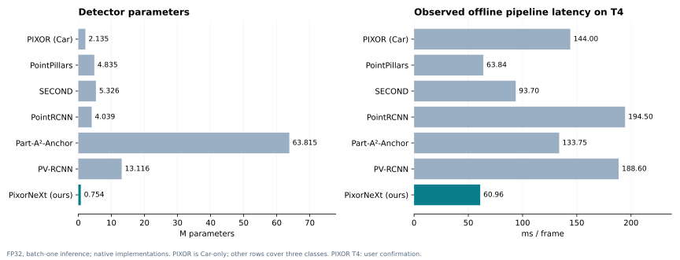

# Báo cáo so sánh LiDAR trên Tesla T4

Ngày tổng hợp: 18/10/2026. Nguồn: opendet_pixornext. Checkpoint chính: PixorNeXt best AP epoch 130.

## 1. Kết quả chính và phạm vi báo cáo

Bộ hồ sơ hiện có đủ để lập bảng timing T4 và ghi nhận kết quả của PIXOR, PixorNeXt cùng năm detector OpenPCDet. PixorNeXt best AP epoch 130 có 753.569 tham số, pipeline offline trung bình 60,96 ms/frame (16,41 FPS), forward 17,88 ms và decode/NMS 14,94 ms. AP local BEV Moderate macro là 71,46%. Đây là mô hình không focal context, dùng BlockSimAM tại c3/c4/c5 và shared grouped heads + IQA; khác run P16/Final3D cũ.

T4 của PIXOR đã được người dùng kiểm tra và xác nhận trong cuộc trao đổi ngày 18/10/2026. Báo cáo chấp nhận xác nhận này; nguồn được ghi là user confirmation vì report_pixor.json không có trường GPU. FP32 và 3.759 mẫu timing của PIXOR có trong report; batch-one profiling được xác định từ runner hiện có. T4/FP32/batch-one của năm baseline có metadata; PixorNeXt có metadata T4/FP32 và runner batch-one.

Cả nhóm dùng cùng danh sách 3.769 frame validation. Timing loại 10 frame đầu; AP vẫn sử dụng đủ frame. Đây là đánh giá validation đã dùng chọn checkpoint, không phải hidden-test KITTI. Chưa đồng nhất evaluator AP giữa PixorNeXt và các baseline; báo cáo để trống reference AP của PixorNeXt thay vì xếp hạng các số khác protocol.

## 2. Hiệu quả tính toán trên Tesla T4

| Model | Params (M) | Pipeline (ms) | Pipeline FPS | Pipeline p95 (ms) |
| --- | --- | --- | --- | --- |
| PIXOR (our reproduction; Car) | 2.13 | 144.00 | 6.94 | 159.38 |
| PointPillars | 4.83 | 63.84 | 15.66 | 75.88 |
| SECOND | 5.33 | 93.70 | 10.67 | 107.42 |
| PointRCNN | 4.04 | 194.50 | 5.14 | 213.48 |
| Part-A²-Anchor | 63.81 | 133.75 | 7.48 | 150.49 |
| PV-RCNN | 13.12 | 188.60 | 5.30 | 202.62 |
| PixorNeXt (ours; best AP) | 0.75 | 60.96 | 16.41 | 80.85 |

So với PointPillars, PixorNeXt dùng ít hơn 84.41% tham số. Trong các lần đo đã lưu, mean pipeline latency thấp hơn 4.52% và FPS cao hơn 4.73%. Chênh lệch pipeline với PointPillars nhỏ; đây là quan sát từ các report, chưa có lặp độc lập hoặc kiểm định độ ổn định giữa phiên Colab. Không diễn giải như một cải thiện có ý nghĩa thống kê.

Pipeline PIXOR Car-only chậm hơn PixorNeXt ba lớp khoảng 2.36 lần trong các implementation được đo. Đây là đối chiếu hai hệ thống có recipe và phạm vi lớp khác nhau; không cô lập hiệu quả riêng của backbone. Các baseline dùng preprocessing và hậu xử lý gốc. Pipeline gồm CPU/IO, chuyển dữ liệu, network và decode/NMS; cùng GPU chưa đồng nghĩa mọi điều kiện CPU, ổ đĩa hoặc tần số GPU đều trùng nhau.

| Model | Preprocess | H2D | Forward/network | Decode/NMS | Total pipeline |
| --- | --- | --- | --- | --- | --- |
| PIXOR (our reproduction; Car) | 34.45 | 29.53 | 70.79 | 6.93 | 144.00 |
| PointPillars | 27.75 | 1.36 | 32.13 | 2.30 | 63.84 |
| SECOND | 27.20 | 1.06 | 62.64 | 2.54 | 93.70 |
| PointRCNN | 22.90 | 0.37 | 169.36 | 1.69 | 194.50 |
| Part-A²-Anchor | 28.26 | 1.04 | 102.57 | 1.66 | 133.75 |
| PV-RCNN | 25.08 | 1.02 | 160.79 | 1.52 | 188.60 |
| PixorNeXt (ours; best AP) | 20.94 | 6.91 | 17.88 | 14.94 | 60.96 |

Đơn vị bảng stage là ms/frame. Forward/network không phải ranh giới hoàn toàn đồng nhất: network OpenPCDet có thể chứa decode và proposal NMS nội bộ; model PixorNeXt trả đầu ra trước hậu xử lý riêng. Vì vậy ưu tiên pipeline latency khi đối chiếu hệ thống và giữ tên stage gốc. Không lấy 55,94 model forwards/s của PixorNeXt làm FPS pipeline; pipeline thực tế là 16,41 FPS. Các stage có thể không cộng chính xác bằng total do overhead biên đo.

## 3. Kết quả Car BEV R40 theo reference evaluator

| Model | Reference Car Easy (%) | Reference Car Moderate (%) | Reference Car Hard (%) | Scope / status |
| --- | --- | --- | --- | --- |
| PIXOR (our reproduction) | 82.79 | 72.02 | 68.37 | Car only; train-derived projection prior |
| PointPillars | 92.02 | 88.02 | 86.63 | Reference BEV R40 |
| SECOND | 92.42 | 88.56 | 87.65 | Reference BEV R40 |
| PointRCNN | 93.74 | 88.42 | 86.44 | Reference BEV R40 |
| Part-A²-Anchor | 92.87 | 90.05 | 88.34 | Reference BEV R40 |
| PV-RCNN | 92.94 | 90.29 | 88.50 | Reference BEV R40 |
| PixorNeXt (ours; best AP) | CHỜ CHẤM | CHỜ CHẤM | CHỜ CHẤM | CHỜ CHẤM REFERENCE; local AP để ở bảng riêng |

PIXOR là PIXOR (our reproduction, 50 epochs), chỉ đánh giá Car; 72,02% là Car Moderate AP, không phải mAP ba lớp. PIXOR và năm baseline dùng cùng revision và SHA-256 evaluator reference. Native input ROI/FOV và phương pháp tạo bbox projection khác nhau được khai báo ở phần protocol. Chưa có reference Car AP của PixorNeXt trong hồ sơ; 86,90% Car local AP không được điền vào cột này.

## 4. Kết quả ba lớp BEV R40 theo reference evaluator

| Model | Reference Car M (%) | Reference Ped. M (%) | Reference Cyc. M (%) | Reference BEV mAP M (%) | Status |
| --- | --- | --- | --- | --- | --- |
| PointPillars | 88.02 | 56.01 | 66.34 | 70.13 | Reference BEV R40 |
| SECOND | 88.56 | 56.56 | 71.16 | 72.09 | Reference BEV R40 |
| PointRCNN | 88.42 | 57.84 | 73.87 | 73.38 | Reference BEV R40 |
| Part-A²-Anchor | 90.05 | 64.20 | 74.60 | 76.28 | Reference BEV R40 |
| PV-RCNN | 90.29 | 58.48 | 74.54 | 74.44 | Reference BEV R40 |
| PixorNeXt (ours; best AP) | CHỜ CHẤM | CHỜ CHẤM | CHỜ CHẤM | CHỜ CHẤM | CHỜ CHẤM REFERENCE |

Macro mAP là trung bình không trọng số của Car, Pedestrian và Cyclist ở Moderate. PIXOR không xuất hiện trong bảng macro vì không có hai lớp còn lại. Trong năm baseline reference hiện có, Part-A²-Anchor có mAP cao nhất (76,28%). Chưa kết luận vị trí của PixorNeXt trong nhóm reference khi chưa chấm lại; cũng không ghép reference AP 3D của Final3D cũ với timing của mô hình BEV hiện tại.

## 5. PixorNeXt: best AP và best loss trên cùng local protocol

| Checkpoint | Epoch | Local Car M (%) | Local Ped. M (%) | Local Cyc. M (%) | Local BEV mAP M (%) | Pipeline (ms) | Pipeline FPS | Model (ms) | Decode/NMS (ms) |
| --- | --- | --- | --- | --- | --- | --- | --- | --- | --- |
| Best AP (primary) | 130 | 86.90 | 60.75 | 66.73 | 71.46 | 60.96 | 16.41 | 17.88 | 14.94 |
| Best loss (sensitivity) | 47 | 82.71 | 62.30 | 69.43 | 71.48 | 81.23 | 12.31 | 22.73 | 30.89 |

Giữ best AP epoch 130 làm kết quả chính theo policy đã khai báo; best loss epoch 47 dùng để phân tích độ nhạy. Best loss cao hơn local macro AP khoảng 0,01549 điểm phần trăm, nhưng không vì chênh lệch này mà đổi policy chọn checkpoint sau khi xem kết quả. Config hash của hai report giống nhau, checkpoint hash khác nhau. Mỗi hàng dùng AP và timing của chính checkpoint đó.

Best AP có timing thấp hơn best loss trong các report đã lưu. Decode/NMS thay đổi theo đầu ra dự đoán; phần chênh lệch forward giữa hai lần đo chưa được cô lập khỏi môi trường thực thi. Không quy toàn bộ thay đổi timing cho lựa chọn checkpoint hoặc kiến trúc. Các kết quả local này là bằng chứng nội bộ và không được so trực tiếp với reference AP ở hai bảng trên.

## 6. Điều kiện đã chung và khác biệt còn lại

| Hạng mục | Tình trạng | Cách sử dụng |
| --- | --- | --- |
| GPU | Tesla T4 cho cả bảy; PIXOR theo xác nhận người dùng | Dùng nhãn T4; giữ nguồn xác nhận PIXOR |
| Precision / inference | FP32; baseline batch 1 theo metadata, hai runner BEV batch 1 | Khai báo ranh giới timing và warmup |
| Validation | 3.769 frame, cùng thứ tự ID; canonical/raw hashes đối chiếu | Giữ split cố định; không gọi hidden test |
| AP evaluator | PIXOR + năm baseline: reference; PixorNeXt: local | Chờ reference BEV AP của PixorNeXt |
| Lớp và metric | PIXOR Car-only; mô hình còn lại ba lớp | Tách bảng Car và macro; dùng BEV khi có PIXOR/PixorNeXt |
| Pre/postprocessing, input ROI | Giữ theo implementation; không hoàn toàn giống nhau | Khai báo đầy đủ; GT reference full-frame |
| Training recipe / budget | PIXOR 50 epochs; ours config 160; baseline pretrained recipe riêng | So các hệ thống đã train; không gọi matched-training ablation |
| PIXOR projection | Train-only median Car height/bottom-z | Khai báo đây là prior để projection, không phải dự đoán 3D |

PIXOR report ghi prior Car height=1,5 m và bottom-z=−1,5370027417 m, lấy từ train. Prior phục vụ chuyển footprint BEV thành annotation KITTI và ảnh hưởng bbox/difficulty của prediction. Với mô hình BEV hiện tại của PixorNeXt, cần khai báo adapter projection tương ứng trước khi dùng reference BEV. Không tạo AP3D từ chiều cao prior rồi coi đó là khả năng dự đoán vertical.

## 7. Bước còn lại để hoàn tất bảng accuracy chung

Giữ nguyên checkpoint best AP epoch 130 và các kết quả baseline đã có. Lấy evaluation_ap_local_bev_T4.predictions.npz đã lưu trên Drive; report ghi SHA-256 5a2fd94c05953db6195d3dde0ac6af273a6911535757864be0fabe905e08d1f2. File này chưa có trong thư mục nguồn tại lúc lập báo cáo. Không có đủ predictions/labels/calibration tại chỗ để chấm lại reference trong lần tổng hợp này.

Chuyển saved footprint sang KITTI annotation bằng một adapter được khai báo: dùng calibration và kích thước ảnh thật theo frame, dùng Car prior giống PIXOR; các lớp còn lại tính prior từ train rồi giữ cố định. Giữ nguyên score và footprint, không đọc GT validation để ước lượng vertical hoặc chọn prior. Adapter phải kiểm tra yaw, thứ tự kích thước, projection và việc lọc prediction. Đối chiếu sensitivity của prior nếu chúng ảnh hưởng đáng kể AP.

Chấm annotations bằng pinned reference BEV R40 trên GT full-frame với IoU Car=0,7 và Pedestrian/Cyclist=0,5. Sau khi có report, điền các ô còn trống trong bảng Car và macro ba lớp. Đây là chấm lại saved predictions, không cần train lại. Timing đang là raw input-to-BEV-detections; nếu pipeline cuối bao gồm adapter projection hoặc thay đổi hậu xử lý thì đo/khai báo thêm phần đó, không dùng timing cũ để đại diện cho pipeline mở rộng.

## 8. Đoạn mô tả có thể dùng trong bản thảo

English — efficiency: In the saved Tesla T4 FP32 measurements, the AP-selected PixorNeXt checkpoint contains 0.754 million detector parameters and achieves a mean sequential offline input-to-BEV-detections latency of 60.96 ms per frame (16.41 FPS). Timing excludes the first ten frames and covers 3,759 validation frames. Compared with the evaluated PointPillars implementation, it uses 84.41% fewer parameters and has a 4.52% lower observed mean pipeline latency. Implementations retain their native preprocessing and postprocessing; the small latency difference has not been validated across independent profiling sessions. The PIXOR reproduction is Car-only, while the remaining detectors cover three classes.

English — accuracy status: The current PixorNeXt checkpoint achieves 71.46% Moderate macro AP under the local loader-aligned BEV R40 protocol. PIXOR and the five OpenPCDet baselines were evaluated with the pinned full-frame reference evaluator. These scores are reported separately pending reference BEV evaluation of PixorNeXt and are not used to claim a common-protocol accuracy ranking.

## 9. Nguồn, xác minh và các tệp bàn giao

Nguồn chính là report JSON trong thư mục người dùng cung cấp; bản sao nguyên trạng và SHA-256 nằm trong sources/ và source_manifest.json. Các prediction text của năm baseline được đối chiếu ID và hash, không chép toàn bộ vào gói báo cáo. Mean latency baseline được tính lại từ CSV từng frame để đối chiếu report. Với PIXOR và PixorNeXt, chỉ có summary timing trong thư mục nên chưa tính lại phân phối từ từng frame. File verification.json ghi phạm vi kiểm tra. Không có training, inference hoặc AP evaluation mới được thực hiện khi tạo báo cáo.

Tài liệu protocol: KITTI BEV Evaluation https://www.cvlibs.net/datasets/kitti/eval_object.php?obj_benchmark=bev; pinned OpenPCDet evaluator https://github.com/open-mmlab/OpenPCDet/tree/233f849829b6ac19afb8af8837a0246890908755/pcdet/datasets/kitti/kitti_object_eval_python. Hai nguồn này mô tả tiêu chí đánh giá; toàn bộ số liệu thực nghiệm trong báo cáo lấy từ report cục bộ. Hướng dẫn implementation trong Code/docs/openpcdet_benchmark.md và Code/docs/pixor_training_notebook.md.
