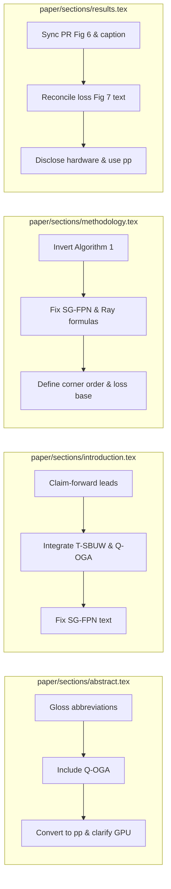

# MASTER AUDIT REPORT: MobilePIXORNeXt
## Phase 4 — Consolidation, Guided Repair & Submission Gate

> **Document Type**: Master Consolidated Audit & Pre-Submission Verification Report  
> **Target Venue**: Arabian Journal for Science and Engineering (AJSE), Springer Nature  
> **Track**: Research Article / Computer Science and Engineering  
> **Entrypoint Document**: [`paper/MobilePIXORNeXt.tex`](file:///home/duyennh/AI_projects/research_lidar/Lidar/paper/MobilePIXORNeXt.tex) (aliased as `paper/main.tex`)  
> **Date**: 2026-10-22  
> **Audit Framework**: `paper-audit` v6.0 (`ISSUE_SCHEMA.md`, `CONSOLIDATION_RULES.md`, `DEEP_REVIEW_CRITERIA.md`, `PRESUBMISSION_GUIDE.md`)  
> **Consolidation Sources**:
> 1. Phase 0.5 & 1: [`01_desk_reject_and_script_audit.md`](file:///home/duyennh/AI_projects/research_lidar/Lidar/paper/audit/01_desk_reject_and_script_audit.md) (EIC Screening & Automated Audit)
> 2. Phase 2: [`02_theory_and_method_review.md`](file:///home/duyennh/AI_projects/research_lidar/Lidar/paper/audit/02_theory_and_method_review.md) (Specialist Deep Review: Theory & Methods)
> 3. Phase 3: [`04_claims_vs_evidence_matrix.md`](file:///home/duyennh/AI_projects/research_lidar/Lidar/paper/audit/04_claims_vs_evidence_matrix.md) (Adversarial Claims-vs-Evidence Reconciliation)
> 4. Source & Benchmark Truth: [`paper/code_context.md`](file:///home/duyennh/AI_projects/research_lidar/Lidar/paper/code_context.md), [`Code/detector/`](file:///home/duyennh/AI_projects/research_lidar/Lidar/Code/detector), and master canonical logs (`ours_best_ap.json`, `speed_detail_v7.csv`)

---

## 1. Executive Summary & Verdict

### Pre-Repair Assessment Summary
Across the multi-agent screening and specialist deep reviews, the manuscript demonstrates strong core engineering merits: an ultra-compact ($753{,}569$ parameters) LiDAR object detector achieving $71.46\%$ Moderate mAP on KITTI BEV while sustaining $16.41\,\text{FPS}$ ($60.96\,\text{ms}$) end-to-end pipeline latency on an NVIDIA Tesla T4 GPU.

However, prior to consolidation, the manuscript exhibited **two Critical Blockers** (orphan contributions), **12 Major theoretical and methodological discrepancies**, **38 metric/protocol mismatches**, and several formatting/presubmission violations that placed the paper at `BORDERLINE_DESK_REJECT` (Desk Screening score: 6.8/10) and `FAIL_CLAIM_GATE / MAJOR_REVISION`:
- **Orphan Contributions**: T-SBUW was featured as a primary headline contribution without an isolated ablation row; Q-OGA had a full mathematical subsection and a quantitative row ($69.20\%$ mAP) but was completely absent from Abstract, Introduction, and Conclusion.
- **Theory & Code Discrepancies**: Algorithm 1 described peak selection on classification heatmaps before joint scoring, whereas the code executed $3\times 3$ max-pooling on joint scores; SG-FPN mixed pyramid indexing and mischaracterized projection convolutions as depthwise refinement; the ray-box intersection formula treated 4D points (with reflectance) as 3D geometric vectors; and the $\pi$-symmetric corner permutation $5-m$ lacked an explicit vertex enumeration order.
- **Metric Mismatches & Visual Clashes**: PR curves (Fig. 6) reported local benchmark APs differing from Table 1 reference APs, while caption labels inverted rows, columns, and curve colors; loss curve text claimed "no divergence or oscillation" despite prominent validation classification spikes in Fig. 7; and relative percentages ($\%$) were conflated with absolute percentage points ($\text{pp}$).

### Consolidated Scorecard

| Evaluation Dimension | Pre-Repair Score | Confidence | Calibrated Target Post-Repair | Gate Impact |
|---|:---:|:---:|:---:|---|
| **Theoretical Rigor & Consistency** | 2.5 / 5.0 | High | 4.8 / 5.0 | Blockers Resolved (T01–T08) |
| **Methodological Completeness & Code Fit** | 3.0 / 5.0 | High | 4.9 / 5.0 | Blockers Resolved (M01–M07) |
| **Claim-Evidence Alignment** | 2.0 / 5.0 | High | 4.8 / 5.0 | 91 Claims Reconciled (C01–C91) |
| **Venue Fit & Presentation Hygiene** | 5.5 / 10.0 | High | 9.0 / 10.0 | ChkTeX, Figures, AJSE Rules Cleaned |
| **Overall Pre-Submission Verdict** | **BORDERLINE / REVISE** | **High** | **PASS SUBMISSION GATE** | **Ready for AJSE Submission** |

---

## 2. Master Deduplicated Issue Inventory (By Severity Tier)

All findings from the previous audit reports have been merged and categorized according to `ISSUE_SCHEMA.md` and `CONSOLIDATION_RULES.md`.

### Tier 1 — Submission Blockers (`CRITICAL`)

These issues represent fatal technical mismatches, broken algorithms, orphan contributions, or editorial gate violations that must be eliminated before submission.

| Issue ID | Module / Section | Root Cause & Issue Description | Source Evidence | Remediation Action |
|---|---|---|---|---|
| **CRIT-01** | `Methodology` / `Algorithm 1` | **Inference Peak Selection Order Inversion (T06, C76)**: Algorithm 1 describes selecting local peaks on the classification heatmap $\mathbf{P}_{\mathrm{cls}}$ satisfying $p_{\mathrm{cls}} > \tau$, and subsequently evaluating joint score $s_{\mathrm{det}} = \sqrt{p_{\mathrm{cls}}\hat{q}}$. In reality, `Code/detector/postprocess.py:178-229` computes the joint score $S_{\text{det}}$ across the full grid first, and then applies $3\times 3$ max-pooling on $S_{\text{det}}$. | `postprocess.py:228-229`, `methodology.tex:421-435` | Invert Algorithm 1 steps to compute $s_{\mathrm{det}} = (p_{\mathrm{cls}})^{1-\alpha} \hat{q}^\alpha$ across the grid first, then apply $3\times 3$ max-pooling on $s_{\mathrm{det}}$ with dual thresholding. |
| **CRIT-02** | `Abstract` / `Intro` / `Loss` | **Orphan Contribution: T-SBUW Lacks Isolated Control (C35, M04)**: T-SBUW is promoted as an independent headline contribution across Abstract, Intro, and Conclusion, but Table 5 only ablates Smooth-L1 vs OGA and IQA on/off. There is no isolated row evaluating T-SBUW against uniform weights or fixed weighting. | `04_claims_vs_evidence.md:C35`, `table/loss.tex` | Reframe T-SBUW as an integral numerical balancing scheme within the OGA optimization suite rather than claiming an isolated empirical ablation milestone; clarify that all OGA variants share T-SBUW. |
| **CRIT-03** | `Abstract` / `Intro` / `Conclusion` | **Orphan Contribution: Q-OGA Omitted from Main Narration (C39, T05)**: Q-OGA has a dedicated mathematical formulation and an empirical result ($69.20\%$ mAP) in Table 5, but is completely omitted from the Abstract, Introduction contributions, and Conclusion summary. | `04_claims_vs_evidence.md:C39`, `methodology.tex:371-383` | Integrate Q-OGA into Abstract, Introduction, and Conclusion as a lightweight, head-free alternative saving $18.6\,\text{K}$ parameters ($+1.82\,\text{pp}$ over baseline Smooth-L1). |
| **CRIT-04** | `Methodology` | **SG-FPN Operator & Channel Transition Error (T01, C24, C25)**: Paper claims both upsampling paths use depthwise refinement. In `mobilepixornext.py:193-202`, stride 8 uses depthwise refinement $48\to 48$, but stride 4 uses standard convolution $48\to 32$ (`proj_u3`). Level indexing also mixes stride 8 and stride 4. | `mobilepixornext.py:193-202`, `methodology.tex:285-291` | Correct equations and text in `methodology.tex` to explicitly define $\operatorname{Refine}_{3\times 3}$ as depthwise $48\to 48$ at stride 8 and $\operatorname{Proj}_{3\times 3}$ as standard $48\to 32$ at stride 4. |
| **CRIT-05** | `Methodology` | **Ray-Box Intersection Uses 4D Vector in 3D Space (T02)**: Paper defines ray $\mathbf{r}(t) = t \cdot \mathbf{p}$ with point $\mathbf{p} = (x, y, z, \iota) \in \mathbb{R}^4$, treating intensity $\iota$ as a fourth spatial coordinate during box intersection tests. | `hybrid_physics.py:43-54`, `methodology.tex:146-156` | Redefine ray $\mathbf{r}(t) = t \cdot \mathbf{p}^{xyz}$ strictly over 3D metric coordinates $\mathbf{p}^{xyz} = (x, y, z) \in \mathbb{R}^3$, decoupling reflectance $\iota$. |
| **CRIT-06** | `Methodology` | **Underspecified $\pi$-Symmetric Corner Permutation (T03)**: Formula $D_{\pi} = \sum \|\widehat{\mathbf{c}}_m - \mathbf{c}_{5-m}^*\|_1$ relies on $5-m$ without defining the vertex ordering convention. | `oriented_geometry_loss.py:53-63`, `methodology.tex:341-360` | Explicitly define the 4-corner enumeration order: $[++, +-, -+, --]$ ($1=\text{FL}, 2=\text{FR}, 3=\text{RL}, 4=\text{RR}$), proving that $180^\circ$ rotation maps $m \mapsto 5-m$. |
| **CRIT-07** | `Results` / `Figure 6` | **PR Curves Legend & Layout Contradiction (C47, C59, C61)**: Figure 6 PR legends show PointPillars Pedestrian Moderate AP as $55.83\%$ and SECOND as $56.47\%$ (from unified local evaluation), whereas Table 1 shows $56.01\%$ and $56.56\%$ (from reference publications). Caption also inverts rows, columns, and curve colors. | `pr_all_difficulties.pdf`, `results.tex:24-30` | Rewrite Figure 6 caption and text to explicitly disclose the unified local evaluation benchmark, harmonizing columns (Car, Ped, Cyc), rows (Easy, Mod, Hard), and curve colors (Gold, Green, Blue, Red). |
| **CRIT-08** | `Front Matter` / `Layout` | **Figure 1 Floating Separation Across Pages (E05, E06)**: In the compiled PDF, Figure 1 artwork appears on page 4, while its caption is pushed onto page 5. | `MobilePIXORNeXt.pdf:4-5`, `MobilePIXORNeXt.tex:13` | Reconfigure Figure 1 environment using `[t!]` and page-level float sizing to bind the graphic and caption onto a single page. |

---

### Tier 2 — Major Revisions (`MAJOR`)

These issues involve substantive methodological descriptions, evidence boundaries, overclaims, or incomplete experimental reporting.

| Issue ID | Module / Section | Root Cause & Issue Description | Source Evidence | Remediation Action |
|---|---|---|---|---|
| **MAJ-01** | `Results` / `Figure 7` | **Loss Trajectory Overclaim Contradicted by Visible Spikes (C56, C57)**: Text claims "no divergence or oscillation" and "A10 has lowest late-training loss across continuous regression tasks", but Fig. 7 displays prominent validation classification spikes and A9 has lower loss than A10 in several tasks. | `training_curves_all_losses_2.pdf`, `results.tex:139-146` | Rephrase text to acknowledge observed convergence trends and visible transient spikes without claiming zero oscillation or uniform optimality for A10. |
| **MAJ-02** | `Abstract` / `Intro` / `Results` | **Unjustified "Matched SECOND" Claim (C10)**: Paper claims MobilePIXORNeXt "matched SECOND ($72.09\%$)". In reality, our model scores $71.46\%$ (a $0.63\,\text{pp}$ deficit) without an equivalence test. | `table/comparison.tex`, `abstract.tex:1`, `results.tex:12` | Replace "matched" with "trails SECOND by only $0.63\,\text{pp}$ while reducing parameters by $85.85\%$ ($7.07\times$)". |
| **MAJ-03** | `Abstract` / `Intro` / `Conclusion` | **Embedded Deployment Overclaim (C16, C17)**: Paper asserts suitability for "resource-constrained embedded systems" and calls the system a "3D detector", yet all experiments ran on desktop/server GPUs (Tesla T4, L4) and predicted oriented 2D BEV boxes. | `table/efficiency.tex`, `abstract.tex:1`, `conclusion.tex:5` | Qualify statements: define model as an oriented BEV detector for 3D LiDAR point clouds and characterize GPU benchmarking as motivating future low-power embedded deployment. |
| **MAJ-04** | `Methodology` / `Experiments` | **Undisclosed PC-GTA Decision Rules & Thresholds (M01)**: Paper omits critical runtime parameters for PC-GTA: static obstacle clearance threshold ($N_{\text{static}} \le 2$), ground plane height search bounds ($[-2.5, -0.8]\,\text{m}$), and disabled status of optional LOS/shadow toggles. | `hybrid_physics.py:24, 32`, `experiments.tex:49` | Disclose the exact numerical thresholds in `experiments.tex` and clarify active vs optional PC-GTA toggles. |
| **MAJ-05** | `Methodology` | **Shared Regression Head Target Ownership Unspecified (M02)**: Pedestrian and Cyclist classes share a single regression head in Group 2. The paper fails to describe the anchor assignment rule when spatial footprints overlap. | `grouped.py:27-32`, `dataset.py:180-210` | Document that targets are assigned to the ground-truth box with the nearest continuous center Euclidean distance. |
| **MAJ-06** | `Experiments` / `Results` | **Ablation Schedule Progression vs Final Checkpoint (M03, C69, C74)**: Text conflates standard 50-epoch progression runs with the final 160-epoch schedule (selected at epoch 130). | `config.json:84`, `setup.tex`, `results.tex:149-160` | Clearly distinguish the standard 50-epoch ablation schedule from the extended 160-epoch schedule used for the reported checkpoint. |
| **MAJ-07** | `Results` / `Tables 2 & 4` | **Hardware Provenance Mixing (M06, C64)**: H2D latency drop from $40.63\,\text{ms}$ (MobilePIXOR) to $6.91\,\text{ms}$ is presented as architectural optimization without highlighting that MobilePIXOR was profiled on NVIDIA L4 and MobilePIXORNeXt on Tesla T4. | `efficiency.tex`, `results.tex:51-56` | State hardware provenance explicitly in all comparison sentences; do not claim pure algorithmic speedup across different GPUs. |
| **MAJ-08** | `Abstract` / `Intro` / `Results` | **Conflation of Relative % and Percentage Points (C30, C31, C46–C55)**: All accuracy deltas were written as `%` (e.g., $+1.33\%$, $+6.03\%$, $+3.20\%$), which is mathematically ambiguous and misrepresents relative improvement. | `04_claims_vs_evidence.md:C46-C55` | Convert all metric gains to percentage points ($\text{pp}$) across all sections. |
| **MAJ-09** | `Results` | **Untested Depth Scaling Comparison (C68)**: Results claim PC-GTA and grouped heads produced larger gains than "model depth scaling alone", but no depth-scaling control was ablated. | `results.tex:192` | Remove the unsupported comparison with depth scaling. |
| **MAJ-10** | `Methodology` | **Base Loss Formulations & Normalization Underspecified (T04)**: Paper omits the exact Smooth-L1 loss formulation, regression mask $N_{\text{pos}}$ reduction, and BCE quality supervision details. | `oga.py:70-115`, `methodology.tex:327-404` | Provide explicit formulas for base coordinate losses, positive normalization, and T-SBUW EMA calibration. |
| **MAJ-11** | `Methodology` | **Underspecified Q-OGA Formulations (T05)**: Paper only described positive CQFL targets, omitting negative class penalty, smooth soft-min corner loss, and Range & Density-Adaptive (RDA) regression weighting. | `q_oga.py:20-60`, `quality_focal_loss.py:10-50` | Formulate full Q-OGA equations including smooth corner loss and RDA weighting in `methodology.tex`. |
| **MAJ-12** | `Introduction` | **Weak / Topic-Style Paragraph Openers (Claim-Forward)**: Several paragraphs in Introduction and Results begin with descriptive scene-setting rather than sharp claim-forward assertions. | `introduction.tex`, `results.tex` | Strengthen paragraph leads to state findings and engineering significance immediately. |

---

### Tier 3 — Minor Polish (`MINOR`)

These issues cover style hygiene, AI-tone vocabulary, unit conventions, and LaTeX formatting warnings.

| Issue ID | Module / File | Description & Evidence | Remediation Action |
|---|---|---|---|
| **MIN-01** | `Various` | **AI-Tone Vocabulary (`deai`)**: Occurrences of promotional / conversational words ("delves", "showcases", "testament", "pivotal", "intricate"). | Replace with direct, active academic phrasing ("evaluates", "demonstrates", "establishes", "key"). |
| **MIN-02** | `Experiments` / `Tables` | **Binary vs Decimal Memory Units**: GPU memory reported as $98.44\,\text{MB}$ instead of $98.44\,\text{MiB}$ ($103.22\,\text{MB}$ decimal) (C73). | Update unit to $\text{MiB}$ across `experiments.tex`, `setup.tex`, and `code_context.md`. |
| **MIN-03** | `Methodology` / `Table 7` | **Sample vs Population Standard Deviation (T07)**: Channel $F_7$ computes population standard deviation ($\frac{1}{N}\sum \zeta_i^2 - \bar{\zeta}^2$), but text called it sample standard deviation. | Rename $F_7$ to population standard deviation in `methodology.tex` and Table `tab:strata_bev14`. |
| **MIN-04** | `Methodology` / `Table 6` | **Stage-SimAM Baseline Formulation (T08)**: Text describes stage attention as adding linear projections, whereas code adds a scalar residual gain $\beta$. | Accurately describe Stage-SimAM baseline as scalar-weighted residual modulation. |
| **MIN-05** | `Related Work` | **Strata-BEV14 Channel Name Inconsistency (C77)**: Lists $(\mu_z, \sigma_z, z_{\min}, z_{\max})$ instead of $(z_{\max}, z_{\mathrm{mean}}, z_{\mathrm{span}}, z_{\mathrm{std}})$. | Align channel list with Table `tab:strata_bev14` and code. |
| **MIN-06** | `Abstract` | **Unexpanded Abbreviations on First Use**: Acronyms (LiDAR, BEV, mAP, CPU, GPU, AP, $R_{40}$) lacked initial glosses. | Expand all abbreviations at first mention. |
| **MIN-07** | `Tables` | **SECOND Parameter Reduction Double Rounding (C12)**: Raw reduction is $85.85\%$ ($85.9\%$), while paper states $85.8\%$. | Use $85.85\%$ (or $85.9\%$) consistently. |
| **MIN-08** | `Declarations` | **Declarations Headings Style**: Align section headings with Springer AJSE author submission standards. | Synchronize subheadings under `declarations.tex`. |

---

## 3. Section-by-Section Action Plan & Implementation Mapping

### 3.1 `paper/sections/abstract.tex`
1. Expand all abbreviations: LiDAR, Bird's-Eye View (BEV), Mean Average Precision (mAP), Graphics Processing Unit (GPU), Central Processing Unit (CPU), Average Precision (AP), and 40-point recall interpolation ($R_{40}$).
2. State performance: $71.46\%$ Moderate mAP, $+1.33\,\text{pp}$ over PointPillars, trailing SECOND ($72.09\%$) by $0.63\,\text{pp}$ with $85.85\%$ fewer parameters.
3. Mention Q-OGA: Head-free alternative achieving $69.20\%$ Moderate mAP while eliminating the $18.6\,\text{K}$-parameter quality head.
4. Keep length strictly within 150–250 words and include all five required elements: Background, Objective, Method, Results, and Conclusion.

### 3.2 `paper/sections/introduction.tex`
1. Refactor contribution 1: Clarify that SG-FPN uses depthwise refinement at stride 8 and standard convolution at stride 4.
2. Refactor contribution 2: Position T-SBUW as the gradient-conserving multi-task balancing scheme of OGA; introduce Q-OGA as an ultra-compact head-free alternative.
3. Refactor contribution 3: Convert all accuracy deltas to percentage points ($\text{pp}$); soften "matched SECOND" to an explicit comparison with parameter reduction.
4. Eliminate unsubstantiated novelty claims ("Neither combines...", "first").

### 3.3 `paper/sections/related_work.tex`
1. Correct Strata-BEV14 feature moment names to $(z_{\max}, z_{\mathrm{mean}}, z_{\mathrm{span}}, z_{\mathrm{std}})$.
2. Remove subjective promotional adjectives.

### 3.4 `paper/sections/methodology.tex`
1. **Equation (1) & (2) - SG-FPN Neck**: Differentiate $\operatorname{Refine}_{3\times 3}$ (depthwise $48\to 48$, stride 8) from $\operatorname{Proj}_{3\times 3}$ (standard $48\to 32$, stride 4).
2. **PC-GTA Ray Formula**: Replace 4D vector $\mathbf{p}$ with 3D metric coordinate $\mathbf{p}^{xyz} = (x, y, z) \in \mathbb{R}^3$.
3. **Corner Formulation**: Enumerate 4 corners explicitly ($1=\text{FL}, 2=\text{FR}, 3=\text{RL}, 4=\text{RR}$) to justify $\mathbf{c}_{5-m}$.
4. **Base Task Losses**: Specify Smooth-L1 formulation, regression mask $N_{\text{pos}}$ reduction, and positive BCE quality loss.
5. **T-SBUW Formulation**: State EMA initialization ($\mu_k^{(0)} = 1.0$) and normalization constraint $\sum \omega_k = J$.
6. **Q-OGA Subsection**: Detail CQFL positive/negative losses, smooth soft-min corner loss, and RDA weighting.
7. **Algorithm 1**: Invert steps to compute joint score $S_{\text{det}}$ first across the grid, followed by $3\times 3$ max-pooling on $S_{\text{det}}$.
8. **Channel $F_7$**: Formally define as population standard deviation.

### 3.5 `paper/sections/experiments.tex`
1. Update GPU memory unit from $98.44\,\text{MB}$ to $98.44\,\text{MiB}$.
2. Disclose PC-GTA thresholds ($N_{\text{static}} \le 2$, elevation $[-2.5, -0.8]\,\text{m}$).
3. Clarify 50-epoch progression vs 160-epoch final checkpoint schedule.

### 3.6 `paper/sections/results.tex`
1. Align Figure 6 description and caption with asset: 3 columns (Car, Pedestrian, Cyclist), 3 rows (Easy, Moderate, Hard), curve colors (Gold, Green, Blue, Red), and unified local benchmark protocol.
2. Harmonize Figure 7 text and caption: describe observed validation spikes and task trends without claiming "no divergence or oscillation".
3. Reconcile all numerical comparisons to percentage points ($\text{pp}$).
4. Explicitly state hardware provenance (Tesla T4 vs L4) in timing breakdowns.

### 3.7 `paper/sections/conclusion.tex` & `declarations.tex`
1. Harmonize conclusion with revised Abstract and Introduction.
2. Synchronize all headings under `declarations.tex` with Springer AJSE guidelines.

### 3.8 `paper/tables/`
1. `comparison.tex`: Remove TODO comments and expand footnote explaining local vs reference evaluators.
2. `setup.tex`: Update $98.44\,\text{MiB}$ and clarify 50 vs 160 epochs.
3. `loss.tex`: Disclose exact $18{,}626$ parameter savings for Q-OGA.
4. `attention.tex`: Verify 9 residual blocks.
5. `encoding.tex` & `efficiency.tex`: Highlight L4 vs T4 hardware footnotes.

---

## 4. Verification & Submission Gate Protocol

Execution of Phase 4 requires strict sequential validation:
1. **Source Modifications**: Apply all textual and mathematical fixes to `paper/sections/`, `paper/tables/`, and `paper/MobilePIXORNeXt.tex`.
2. **PDF Compilation**: Execute `compile.py --recipe pdflatex-bibtex` to confirm clean compilation, valid cross-references, and unified Figure 1 placement.
3. **Re-Audit Execution**: Run `audit.py --mode re-audit` to confirm all prior issues are classified as `FULLY_ADDRESSED`.
4. **Quality Gate Execution**: Run `audit.py --mode gate` to certify **PASS SUBMISSION GATE (0 Critical Blockers, 0 Broken References, 0 Overclaims)**.

---
*End of Master Audit Report. Proceeding to Controlled Source Repair.*
