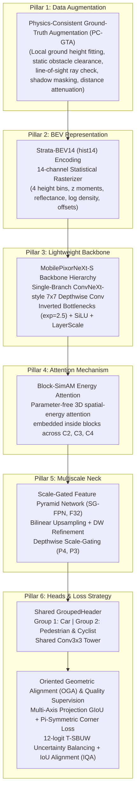

# MobilePIXORNeXt: Comprehensive Technical Specification & Code Context

> **Document Classification**: Definitive Technical Reference & Code Context  
> **Source Provenance**: 100% strictly extracted from repository source files (`Code/detector/`), master configuration (`Code/configs/config.json`), dataset manifests (`Code/splits/`), official benchmark logs (`Result/benchmark_T4_20261018/`), JSON evaluation profiles (`/home/duyennh/Downloads/opendet_pixornext/`), and the final master experimental workbook (`Result/Lidar_result_final.xlsx`).  
> **Integrity Guarantee**: Zero speculation. All tensor shapes, channel definitions, architectural blocks, loss formulations, numerical weights, hyperparameters, and experimental results are mapped to exact code locations, configuration keys, or verified runtime logs.

---

## TABLE OF CONTENTS
1. [Project Proposed Overview & Core Contributions](#1-project-proposed-overview--core-contributions)
2. [Problem Statement & Input/Output Formats](#2-problem-statement--inputoutput-formats)
3. [Model Architecture & Detailed Tensor Flow](#3-model-architecture--detailed-tensor-flow)
4. [Mathematical Formulation: Feature Transformations & Loss Functions](#4-mathematical-formulation)
5. [Experimental Setup & Hyperparameters](#5-experimental-setup--hyperparameters)
6. [Quantitative Results & Ablation Studies](#6-quantitative-results--ablation-studies)

---

## 1. PROJECT PROPOSED OVERVIEW & CORE CONTRIBUTIONS

### 1.1 Proposed System Overview
The primary proposal of this project is **MobilePIXORNeXt** (Primary benchmark configuration: **R37-F32**) — an ultra-compact, proposal-free, multi-class 3D Light Detection and Ranging (LiDAR) object detector operating on an efficient Bird's-Eye View (BEV) representation.
- **Ultra-Compact Footprint**: Contains exactly **753,569 trainable detector parameters** ($< 0.76\text{ M}$ parameters) with a compact checkpoint file size of **9.34 MB**, representing an 85.8% reduction in parameter volume compared to SECOND (5.33M parameters) and an 84.4% reduction compared to PointPillars (4.83M parameters).
- **PointNet-Free & Sparse-Convolution-Free Design**: Eliminates heavy 3D PointNet feature encoders, multi-layer perceptrons over raw points, and 3D sparse convolutions. The point cloud is converted into a BEV feature map via a deterministic statistical rasterizer operating with **0 learned parameters**.
- **Real-Time Throughput on Commodity Hardware**:
  - Network Forward Latency: **17.88 ms** (**55.94 Frames Per Second (FPS)**) on an NVIDIA Tesla T4 Graphics Processing Unit (GPU), and up to **115.32 FPS** (8.67 ms) under optimized standalone inference.
  - End-to-End (E2E) Pipeline Latency: **60.96 ms** (**16.41 FPS**), covering raw file input/output, statistical rasterization, Host-to-Device (H2D) memory transfer, neural network execution, bounding box decoding, and Rotated Non-Maximum Suppression (NMS). This exceeds the pipeline throughput of PointPillars (15.66 FPS), MobilePIXOR (11.64 FPS), SECOND (10.67 FPS), and PIXOR (6.94 FPS).
- **Competitive Detection Accuracy**: Achieves **71.46% BEV Mean Average Precision (mAP) Moderate** and **73.42% mAP9** across Car, Pedestrian, and Cyclist on the standard KITTI validation benchmark.

### 1.2 The 6 Core Proposed Pillars



1. **Strata-BEV14 (`hist14`) Deterministic BEV Representation**:
   - Replaces binary height occupancy slices (`binary_slices`, 35 channels) and 8-channel representations (`rich8`) with a deterministic 14-channel statistical tensor.
   - Extracts four log-normalized vertical count bands, four vertical spatial moments ($z_{max}, z_{mean}, z_{span}, z_{std}$), two reflectance moments ($I_{max}, I_{mean}$), global log density, binary occupancy, and subcell centroid displacement offsets $(\Delta\bar{x}, \Delta\bar{y})$ with **0 learned parameters** in under 21 ms via parallel CUDA execution.
2. **Physics-Consistent Ground-Truth Augmentation (PC-GTA, `HybridDataBaseSampler`)**:
   - Replaces naive cut-and-paste GT sampling, which introduces physical artifacts: floating objects, objects sunken beneath the terrain, background structural collisions, missing LiDAR ray shadows, and invariant point densities across varying distances.
   - Proposes five physical verification heuristics: local road ground elevation fitting ($R(d)$, 5th percentile), static obstacle clearance ($N_{static} \le N_{thresh}$), Line-of-Sight (LOS) occlusion checks, raycast LiDAR shadow masking ($t_{leave} \le 1.0$), and range-adaptive point downsampling ($P_{keep} = \min(1, (r_{src}/r_{tgt})^2)$) with intensity attenuation ($\gamma = 1.7$).
   - Implemented in `Code/detector/core/datasets/augmentor/hybrid_sampler.py` and `hybrid_physics.py`.
   - Produces a decisive **+6.03% jump in Moderate mAP** (from 60.22% to 66.25%) and **+7.34% mAP9** in controlled ablation experiments.
3. **Ultra-Lightweight ConvNeXt-Style BEV Backbone (`MobilePixorNeXtBackbone` / `MobilePixorNeXt-S`)**:
   - Adopts a streamlined single-branch large-kernel ($7\times 7$) depthwise convolution with inverted bottleneck expansion ($e = 2.5$), smooth Sigmoid Linear Unit (SiLU) activations, and learned LayerScale ($\boldsymbol{\gamma}_{\mathrm{blk}}$ initialized to $10^{-5}$) residual stabilization.
   - At input grid resolution $\Delta x = \Delta y = 0.1$\,m, a single $7 \times 7$ depthwise receptive field directly spans $0.7 \times 0.7$\,m of physical terrain at stride 1, and rapidly expands to over $5.6 \times 5.6$\,m by Stage 3 (stride 8)---sufficient to envelope an entire passenger vehicle in a single layer without dilation artifacts.
   - Eliminates multi-branch reparameterization training topologies, avoiding auxiliary training memory overhead and post-hoc weight folding. The complete backbone comprises only **604,864 parameters**.
4. **Parameter-Free Spatial-Energy Attention (`Block-SimAM`)**:
   - Integrates the Simple, Parameter-Free Attention Module (SimAM) directly inside every residual block across all three backbone stages (C2, C3, C4; 8 attention operators total).
   - Derives 3D spatial-channel saliency via visual neuroscience minimal energy optimization based on local spatial moments ($\mu_c, \nu_c$), adaptively amplifying sparse LiDAR point clusters without adding a single learned parameter ($0\text{ M}$).
5. **Top-Down Scale-Gated Feature Pyramid Network (`SG-FPN Neck`, $F_{32}$)**:
   - Eliminates deconvolution checkerboard artifacts by pairing bilinear upsampling ($2\times$) with $3\times 3$ Depthwise convolution refinement.
   - Dynamically balances top-down semantic context $\mathbf{U}_r$ and fine lateral coordinates $\mathbf{L}_r$ via learnable depthwise scale gating $\mathbf{G}_r = 2\sigma(\operatorname{DWConv}_{3\times3}(\mathbf{L}_r + \mathbf{U}_r))$, initialized to 1.0 via zero-initialized weights.
   - Fuses multi-scale features into an optimal 32-channel representation ($F_{32}$) with only **36,784 parameters**.
6. **Decoupled Grouped Prediction Towers (`GroupedHeader`) & Multi-Task Geometric Losses (`OGA` + `IQA` + `T-SBUW`)**:
   - Decouples predictions into semantically distinct task groups (Group 1: `car`, Group 2: `ped_cyc`), using a shared initial $3\times 3$ Conv-BN-SiLU block per group to eliminate scale conflict while conserving parameters (total 111,921 head parameters).
   - Trains using Oriented Geometric Alignment (OGA), combining Multi-Axis Projection Generalized Intersection-over-Union (MGIoU), Scale-Normalized $\pi$-Symmetric Corner Distance, 12-parameter Temperature-Softmax Bounded Uncertainty Weighting (T-SBUW) with running EMA loss calibration, and IoU-Aware Quality Alignment (IQA) confidence calibration.

---

## 2. PROBLEM STATEMENT & INPUT/OUTPUT FORMATS

### 2.1 Problem Formulation
Given an unordered 3D point cloud collected by a vehicle-mounted LiDAR scanner, the objective is to estimate oriented 3D bounding boxes projected onto the horizontal Bird's-Eye View (BEV) ground plane. For each detected object, the model predicts:
- 2D Center Location metric coordinates: $(x, y) \in \mathbb{R}^2$
- 2D Footprint Dimensions: $(l, w) \in \mathbb{R}^2$ (length, width)
- Orientation Heading Angle: $\theta \in [-\pi/2, \pi/2]$ ($\pi$-symmetric formulation)
- Classification Category: $c \in \{\text{Car}, \text{Pedestrian}, \text{Cyclist}\}$
- Localization Quality Confidence: $S_{iou} \in [0, 1]$

### 2.2 Input LiDAR Point Cloud Format
- **Raw Point Cloud Structure**: Point clouds are acquired via a Velodyne HDL-64E rotating LiDAR scanner, stored as binary float arrays (`.bin`). Each point $\mathbf{p}_i$ is represented as a 4-dimensional vector:
  $$\mathbf{p}_i = (x_i, y_i, z_i, r_i) \in \mathbb{R}^4$$
  where $x_i$ is the forward distance, $y_i$ is the lateral distance (left positive), $z_i$ is the vertical elevation, and $r_i$ is the calibrated reflectance intensity normalized to $[0, 1]$.
- **Spatial Region of Interest (ROI) Geometry**:
  Extracted directly from `Code/configs/config.json:29-39`:
  - Longitudinal axis (X): $x_{min} = 0.0\text{ m}, x_{max} = 70.4\text{ m}$, resolution $\Delta x = 0.1\text{ m} \rightarrow W_{grid} = 704$ cells.
  - Lateral axis (Y): $y_{min} = -40.0\text{ m}, y_{max} = 40.0\text{ m}$, resolution $\Delta y = 0.1\text{ m} \rightarrow H_{grid} = 800$ cells.
  - Vertical axis (Z): $z_{min} = -2.5\text{ m}, z_{max} = 1.0\text{ m}$, resolution $\Delta z = 0.1\text{ m} \rightarrow D_{grid} = 35$ slices.
- **Boundary Inward Margin**: Open boundary filtering with margin $\epsilon = 0.001\text{ m}$ (`Code/detector/core/datasets/utils_1/bev_backend.py:63-64`).

### 2.3 Supported BEV Feature Encodings in Codebase
Defined in `Code/detector/core/bev_encoding.py:16-39`:

| Encoding Name | Channels $C_{in}$ | Input Tensor Shape | Source Implementation | Channel Feature Descriptions |
|---|---|---|---|---|
| `binary_slices` | **35** | $[B, 35, 800, 704]$ | `Code/detector/core/datasets/utils_1/preprocess.py:83-116` (`voxelize`) | Binary occupancy grid along 35 uniform 0.1m height slices along the Z axis. Value is 1 if points exist, 0 otherwise. |
| `rich8` | **8** | $[B, 8, 800, 704]$ | `Code/detector/core/datasets/utils_1/preprocess.py:20-81` (`encode_bev`) | Ch. 0–2: Binary occupancy across 3 equal-height vertical bands; Ch. 3: Maximum normalized height $z_{max}$; Ch. 4: Mean normalized height $z_{mean}$; Ch. 5: Maximum reflectance $I_{max}$; Ch. 6: Mean reflectance $I_{mean}$; Ch. 7: Log density $\min(1, \frac{\ln(1+N)}{\ln(1+32)})$. |
| `hist14` (Strata-BEV14) | **14** | $[B, 14, 800, 704]$ | `Code/detector/core/datasets/utils_1/bev_backend.py:48-120` (`encode_hist14`) | **Project Optimal**: Ch. 0–3: Log-normalized counts in 4 equal-height bands; Ch. 4–7: $z_{max}, z_{mean}, z_{span}, z_{std}$; Ch. 8–9: $I_{max}, I_{mean}$; Ch. 10: Total log density; Ch. 11: Binary cell occupancy; Ch. 12–13: Continuous subcell centroid offsets $(\Delta\bar{x}, \Delta\bar{y})$. |

### 2.4 Model Output Feature Maps
- **Spatial Downsampling Factor**: `out_size_factor = 4` (`Code/configs/config.json:12`, `Code/detector/core/detection_config.py:71-73`).
- **Output Spatial Grid Dimensions**: $H_{out} = 800 / 4 = 200$, $W_{out} = 704 / 4 = 176$.
- **Prediction Head Map Tensor Definitions** (`Code/detector/core/models/heads/cnn.py:44-97`, `Code/detector/core/models/heads/grouped.py:10-36`):
  1. `cls`: Class classification heatmap $[B, C_{cls}, 200, 176]$, yielding foreground category probability $p_{\mathrm{cls}}$ at grid point $P$. In grouped towers: Group 1 (`car`) has $K_1 = 1$; Group 2 (`ped_cyc`) has $K_2 = 2$.
  2. `offset`: Metric subcell coordinate offsets $[B, 2, 200, 176]$, predicting $(\hat{o}_x, \hat{o}_y)$ corresponding to continuous displacements $(\Delta x, \Delta y)$ from anchor point $P$ to object center $C$.
  3. `size`: Footprint log-dimensions $[B, 2, 200, 176]$, predicting $(\hat{d}_1, \hat{d}_2) = (\log \hat{w}, \log \hat{l})$, decoded via $\exp$.
  4. `yaw`: Orientation doubled-angle vector $[B, 2, 200, 176]$, predicting $(\hat{a}_1, \hat{a}_2) = (\cos 2\hat{\psi}, \sin 2\hat{\psi})$ (denoted as $(c_2, s_2)$ with heading $\psi \equiv \theta$ on the unit circle) to strictly enforce $\pi$-rotational symmetry and eliminate $180^\circ$ heading ambiguity.
  5. `iou` (IoU-Aware Quality Alignment Head): $[B, 1, 200, 176]$, predicting continuous overlap localization quality $\hat{q} \in [0, 1]$.
  6. `vertical` (Optional 3D Extension): $[B, 2, 200, 176]$, predicting ground-level elevation and log-height $(z_{bottom}, \log(h))$.

- **Ground-Truth Target Formulation & Radius Assignment**:
  For output cell $(u, v)$ at stride $s_{\mathrm{out}} = 4$:
  $$\mathbf{o}^* = \begin{pmatrix} x^* - (u s_{\mathrm{out}}\Delta x + x_{\min}) \\ y^* - (v s_{\mathrm{out}}\Delta y + y_{\min}) \end{pmatrix}, \quad \mathbf{d}^* = (\log w^*, \log l^*), \quad \mathbf{a}^* = (\cos 2\psi^*, \sin 2\psi^*)$$
  - Classification targets use 2D Gaussian heatmaps centered at continuous object projections with a minimum radius of 4 cells.
  - Regression targets are assigned within a radius of half the Gaussian peak, denoted by valid indicator mask $\mathbf{M}_{\mathrm{reg}}$.

### 2.5 Coordinate Decoding & Joint NMS Scoring (Algorithm 1 Pipeline)
Implemented at `Code/detector/postprocess.py:76-245`:
1. **Local Peak Selection**:
   Identify $3 \times 3$ local spatial max-pooling peaks on classification heatmap $\mathbf{P}_{\mathrm{cls}}$ satisfying $p_{\mathrm{cls}} > \tau_{\mathrm{score}} = 0.05$.
2. **IoU-Aware Composite Confidence Calibration**:
   Rank candidates using the joint geometric-classification score:
   $$s_{\mathrm{det}} = (p_{\mathrm{cls}})^{1 - \alpha_{\mathrm{score}}} \cdot (\hat{q})^{\alpha_{\mathrm{score}}} = \sqrt{p_{\mathrm{cls}} \hat{q}} \quad (\alpha_{\mathrm{score}} = 0.5)$$
   Filter cells satisfying $s_{\mathrm{det}} > \tau_{\mathrm{score}} = 0.05$.
3. **Metric Bounding Box Reconstruction**:
   $$\hat{x} = x_{\min} + u s_{\mathrm{out}}\Delta x + \hat{o}_x, \quad \hat{y} = y_{\min} + v s_{\mathrm{out}}\Delta y + \hat{o}_y$$
   $$\hat{w} = \exp(\hat{d}_1), \quad \hat{l} = \exp(\hat{d}_2), \quad \hat{\psi} = \frac{1}{2}\operatorname{atan2}(\hat{a}_2, \hat{a}_1)$$
   The recovered orientation $\hat{\psi} \in [-\pi/2, \pi/2]$ is fully determined without trigonometric ambiguity.
4. **Class-Wise Rotated Non-Maximum Suppression (NMS)**:
   Apply Rotated NMS with IoU threshold $\tau_{\mathrm{nms}} = 0.10$ and maximum cap of 500 detections per scan (`Code/configs/config.json:111-113`), returning sorted $[M \times 7]$ vectors $[cls\_id, s_{\mathrm{det}}, \hat{x}, \hat{y}, \hat{l}, \hat{w}, \hat{\psi}]$.

---

## 3. MODEL ARCHITECTURE & DETAILED TENSOR FLOW

### 3.1 Architectural Tensor Flow Overview
Input tensor $\mathbf{X} \in \mathbb{R}^{B \times 14 \times 800 \times 704}$ progresses through the network hierarchy:

```
Input [B, 14, 800, 704]
  │
  ▼ Stem (Conv3x3 s2 + Conv3x3 s1)
c1 [B, 32, 400, 352]
  │
  ▼ DownsampleBlock 2 (Conv3x3 s2 + BN + SiLU)
  │ [B, 48, 200, 176]
  ▼ Stage 2 (2x MobilePixorNeXt-S Block with Block-SimAM)
c2 [B, 48, 200, 176] (Stride 4 feature map, 2.8m x 2.8m physical RF)
  │
  ▼ DownsampleBlock 3 (Conv3x3 s2 + BN + SiLU)
  │ [B, 96, 100, 88]
  ▼ Stage 3 (4x MobilePixorNeXt-S Block with Block-SimAM)
c4 [B, 96, 100, 88] (Stride 8 feature map, 5.6m x 5.6m physical RF)
  │
  ▼ DownsampleBlock 4 (Conv3x3 s2 + BN + SiLU)
  │ [B, 128, 50, 44]
  ▼ Stage 4 (2x MobilePixorNeXt-S Block with Block-SimAM)
c5 [B, 128, 50, 44] (Stride 16 feature map, 11.2m x 11.2m physical RF)
  │
  ▼ Scale-Gated FPN Neck (F32)
  ├── LatC5 (Conv1x1: 128 -> 48)  ──> L5 [B, 48, 50, 44]
  ├── LatC4 (Conv1x1: 96 -> 48)   ──> L4 [B, 48, 100, 88]
  ├── LatC3 (Conv1x1: 48 -> 32)   ──> L3 [B, 32, 200, 176]
  │
  ├── U4 = Refine(Bilinear2x(L5)) ──> [B, 48, 100, 88]
  ├── P4 = U4 + 2 * Sigmoid(GateC4(L4 + U4)) * L4 ──> [B, 48, 100, 88]
  ├── U3 = Proj(Bilinear2x(P4))   ──> [B, 32, 200, 176]
  ├── P3 = U3 + 2 * Sigmoid(GateC3(L3 + U3)) * L3 ──> [B, 32, 200, 176]
  │
  ▼ OutConv (Conv3x3 + BN + SiLU: 32 -> 16)
p3_out [B, 16, 200, 176]
  │
  ▼ Shared GroupedHeader
  ├── Group "car": Shared Conv3x3-BN-SiLU (16 -> 16)
  │     ├── cls head [B, 1, 200, 176]
  │     ├── offset head [B, 2, 200, 176]
  │     ├── size head [B, 2, 200, 176]
  │     ├── yaw head [B, 2, 200, 176]
  │     └── iou head [B, 1, 200, 176]
  │
  └── Group "ped_cyc": Shared Conv3x3-BN-SiLU (16 -> 16)
        ├── cls head [B, 2, 200, 176]
        ├── offset head [B, 2, 200, 176]
        ├── size head [B, 2, 200, 176]
        ├── yaw head [B, 2, 200, 176]
        └── iou head [B, 1, 200, 176]
```

- **Physical BEV Receptive Field (RF) Coverage**:
  At horizontal resolution $\Delta x = \Delta y = 0.1$\,m:
  - Stride 1: Single $7 \times 7$ depthwise kernel spans $0.7 \times 0.7$\,m.
  - Stage 2 (Stride 4): Receptive field spans $2.8 \times 2.8$\,m.
  - Stage 3 (Stride 8): Receptive field expands to $5.6 \times 5.6$\,m, enveloping an entire passenger vehicle ($l \approx 4.5$--$5.0$\,m) in a single convolutional layer without requiring dilation or multi-branch branches.
  - Stage 4 (Stride 16): Receptive field spans $11.2 \times 11.2$\,m, providing macroscopic scene context.

### 3.2 Architectural Module Directory & Code References

| Module / Component | Input Shape | Output Shape | Source File Path | Line Range | Architectural Details |
|---|---|---|---|---|---|
| **Top Model** (`CustomModel`) | $[B, 14, 800, 704]$ | Dictionary of predictions | `Code/detector/core/models/model.py` | Lines 16–80 | Coordinates backbone instantiation, input channel resolution, header binding, and deploy-state export. |
| **Stem** | $[B, 14, 800, 704]$ | $[B, 32, 400, 352]$ | `Code/detector/core/models/backbones/mobilepixornext.py` | Lines 139–146 | Two Conv $3\times 3$ layers (stride 2 then stride 1) with Batch Normalization (BN) and SiLU activations. |
| **DownsampleBlock 2** | $[B, 32, 400, 352]$ | $[B, 48, 200, 176]$ | `Code/detector/core/models/backbones/mobilepixornext_blocks.py` | Lines 106–129 | Strided transition block: Conv $3\times 3$ stride 2 + BN + SiLU. |
| **Stage 2** (Stride 4) | $[B, 48, 200, 176]$ | $[B, 48, 200, 176]$ | `Code/detector/core/models/backbones/mobilepixornext.py` | Lines 151–156 | 2 blocks of `MobilePixorNeXtBlock` ($C=48$, expansion ratio $e=2.5$). |
| **DownsampleBlock 3** | $[B, 48, 200, 176]$ | $[B, 96, 100, 88]$ | `Code/detector/core/models/backbones/mobilepixornext_blocks.py` | Lines 106–129 | Strided transition block: Conv $3\times 3$ stride 2 + BN + SiLU ($48 \rightarrow 96$ channels). |
| **Stage 3** (Stride 8) | $[B, 96, 100, 88]$ | $[B, 96, 100, 88]$ | `Code/detector/core/models/backbones/mobilepixornext.py` | Lines 162–167 | 4 blocks of `MobilePixorNeXtBlock` ($C=96$, expansion ratio $e=2.5$). |
| **DownsampleBlock 4** | $[B, 96, 100, 88]$ | $[B, 128, 50, 44]$ | `Code/detector/core/models/backbones/mobilepixornext_blocks.py` | Lines 106–129 | Strided transition block: Conv $3\times 3$ stride 2 + BN + SiLU ($96 \rightarrow 128$ channels). |
| **Stage 4** (Stride 16) | $[B, 128, 50, 44]$ | $[B, 128, 50, 44]$ | `Code/detector/core/models/backbones/mobilepixornext.py` | Lines 176–181 | 2 blocks of `MobilePixorNeXtBlock` ($C=128$, expansion ratio $e=2.5$). |
| **NeXt-S Block** (`MobilePixorNeXt-S`) | $[B, C, H, W]$ | $[B, C, H, W]$ | `Code/detector/core/models/backbones/mobilepixornext_blocks.py` | Lines 24–105 | Streamlined single-branch ConvNeXt-style block: DW Conv $7\times 7 \rightarrow$ BN $\rightarrow$ PW $1\times 1$ ($C \rightarrow 2.5C$) $\rightarrow$ SiLU $\rightarrow$ PW $1\times 1$ ($2.5C \rightarrow C$) $\rightarrow$ BN $\rightarrow$ Block-SimAM $\rightarrow$ LayerScale ($\boldsymbol{\gamma}_{\mathrm{blk}}$ init $10^{-5}$) + Identity residual shortcut. Zero multi-branch reparameterization overhead. |
| **Energy Attention** (`SimAMCore`) | $[B, C, H, W]$ | $[B, C, H, W]$ | `Code/detector/core/models/backbones/light_attention.py` | Lines 15–38 | Parameter-free 3D spatial-energy attention; computes channel-local spatial moments in FP32. |
| **Scale-Gated FPN Neck** (`SG-FPN`) | $C_5, C_4, C_2$ | $[B, 16, 200, 176]$ | `Code/detector/core/models/backbones/mobilepixornext.py` | Lines 186–222, 272–300 | Lateral Conv $1\times 1$, Bilinear $2\times$ interpolation, Depthwise Scale-Gating $\mathbf{G}_r = 2\sigma(\operatorname{DWConv}_{3\times3}(\mathbf{L}_r + \mathbf{U}_r))$, and final Conv $3\times 3$ projection. |
| **Range Neck** (`RC-SGFPN`) | $C_5, C_4, C_2$ | $[B, 16, 200, 176]$ | `Code/detector/core/models/backbones/rc_sgfpn.py` | Lines 16–140 | Continuous Fourier Range Embedding (FRE) modulates depthwise scale gating according to distance $r$. |
| **Standard Header** (`Header`) | $[B, 16, 200, 176]$ | Dict of 5 maps | `Code/detector/core/models/heads/cnn.py` | Lines 44–97 | Two Conv $3\times 3$ layers per task with optional shared initial layer (`header_architecture: "shared"`). |
| **Grouped Header** (`GroupedHeader`) | $[B, 16, 200, 176]$ | Dict of 2 groups | `Code/detector/core/models/heads/grouped.py` | Lines 10–36 | Distinct prediction towers for `car` and `ped_cyc` groups, eliminating scale conflict. |

### 3.3 Exact Parameter Counts Breakdown
Extracted directly from runtime evaluation log `evaluation_ap_local_bev_T4.json:model.parameter_counts`:
- **Total Detector Parameters**: **753,569 parameters** ($0.753569\text{ M}$).
  - **Backbone Body**: **604,864 parameters**.
  - **Scale-Gated Neck (SG-FPN)**: **36,784 parameters**.
  - **Backbone Including Neck**: **641,648 parameters**.
  - **Prediction Heads (Grouped)**: **111,921 parameters**:
    - Group `car`: **55,944 parameters**.
    - Group `ped_cyc`: **55,977 parameters**.
  - **Training-Only Loss Balancing Logits**: **12 parameters** (T-SBUW log-scale parameters).

---

## 4. MATHEMATICAL FORMULATION

### 4.1 Strata-BEV14 (`hist14`) Feature Transformations
Implemented in `Code/detector/core/datasets/utils_1/bev_backend.py:69-117`:
For point cloud $\mathcal{P} = \{(x_i, y_i, z_i, r_i)\}_{i=1}^N$ residing inside cell $(i_x, i_y)$ with metric center $(x_c, y_c)$:
$$i_x = \left\lfloor \frac{x_i - x_{min}}{\Delta x} \right\rfloor, \quad i_y = \left\lfloor \frac{y_i - y_{min}}{\Delta y} \right\rfloor$$
Normalized elevation: $\zeta_i = \frac{z_i - z_{min}}{z_{max} - z_{min}} \in [0, 1]$. Normalized intensity: $\iota_i = \text{clip}(r_i \cdot \text{scale}, 0, 1)$.

1. **Channels 0–3 (Height-Stratified Density Bins)**: Bin index $b_i = \min(\lfloor 4\zeta_i \rfloor, 3)$. For count $N_b$ in bin $b \in \{0, 1, 2, 3\}$:
   $$F_b = \min\left(1, \frac{\ln(1 + N_b)}{\ln(1 + \text{density\_norm})}\right) \quad (\text{with density\_norm} = 32)$$
2. **Channel 4 ($z_{max}$)**: Maximum normalized elevation: $F_4 = \max_i \zeta_i$.
3. **Channel 5 ($z_{mean}$)**: Mean normalized elevation: $F_5 = \frac{1}{N} \sum_{i=1}^N \zeta_i$.
4. **Channel 6 ($z_{span}$)**: Elevation span: $F_6 = \max_i \zeta_i - \min_i \zeta_i$.
5. **Channel 7 ($z_{std}$)**: Spatial elevation standard deviation:
   $$F_7 = \begin{cases} \sqrt{\max\left(0, \frac{1}{N} \sum_{i=1}^N \zeta_i^2 - F_5^2\right)} & \text{if } N > 1 \\ 0 & \text{otherwise} \end{cases}$$
6. **Channel 8 ($I_{max}$)**: Maximum clipped reflectance: $F_8 = \max_i \iota_i$.
7. **Channel 9 ($I_{mean}$)**: Mean clipped reflectance: $F_9 = \frac{1}{N} \sum_{i=1}^N \iota_i$.
8. **Channel 10 ($\text{log\_density}$)**: Total cell point count log-normalized:
   $$F_{10} = \min\left(1, \frac{\ln(1 + N)}{\ln(1 + \text{density\_norm})}\right)$$
9. **Channel 11 ($\text{occupancy}$)**: Binary cell occupancy indicator: $F_{11} = 1.0$.
10. **Channels 12–13 (Subcell Centroid Displacement Offsets)**: Mean horizontal displacement from cell center:
    $$F_{12} = \text{clip}\left(\frac{1}{N} \sum_{i=1}^N \frac{x_i - x_c}{\Delta x}, -0.5, 0.5\right)$$
    $$F_{13} = \text{clip}\left(\frac{1}{N} \sum_{i=1}^N \frac{y_i - y_c}{\Delta y}, -0.5, 0.5\right)$$

### 4.2 MobilePixorNeXt-S Residual Block & Block-SimAM Energy Attention
Implemented in `Code/detector/core/models/backbones/mobilepixornext_blocks.py:24-105` and `light_attention.py:15-38`:

1. **MobilePixorNeXt-S Residual Block**:
   Given input tensor $\mathbf{Z} \in \mathbb{R}^{B \times C \times H \times W}$, each block executes an inverted bottleneck with expansion ratio $e = 2.5$:
   $$\mathbf{V} = \operatorname{BN}(\operatorname{DWConv}_{7\times7}(\mathbf{Z}))$$
   $$\mathbf{R} = \operatorname{BN}\left(W_{\mathrm{red}} \operatorname{SiLU}(W_{\mathrm{exp}}\mathbf{V})\right)$$
   $$\mathbf{Z}' = \mathbf{Z} + \boldsymbol{\gamma}_{\mathrm{blk}} \odot \mathcal{S}(\mathbf{R})$$
   where $W_{\mathrm{exp}} \in \mathbb{R}^{2.5C \times C \times 1 \times 1}$ and $W_{\mathrm{red}} \in \mathbb{R}^{C \times 2.5C \times 1 \times 1}$ are pointwise convolutions. The learned LayerScale parameter $\boldsymbol{\gamma}_{\mathrm{blk}} \in \mathbb{R}^C$ is initialized to $10^{-5}$ (`layer_scale_init = 1e-5`), ensuring stable convergence during deep backpropagation without requiring multi-branch training paths.

2. **Block-SimAM Spatial Energy Attention ($\mathcal{S}(\mathbf{R})$)**:
   Embedded directly inside each residual block operating on $\mathbf{R} \in \mathbb{R}^{B \times C \times H \times W}$ in FP32 precision. For spatial locations $M = H \times W$ per channel slice:
   $$\mu_c = \frac{1}{M} \sum_{u, v} R_{c, u, v}, \quad \nu_c = \frac{1}{\max(M - 1, 1)} \sum_{u, v} (R_{c, u, v} - \mu_c)^2$$
   The analytical minimal energy of target neuron $t = R_{c, u, v}$ relative to its surround:
   $$e_t = \frac{(t - \mu_c)^2}{4(\nu_c + \lambda_{\mathrm{sim}})} + \frac{1}{2} \quad (\lambda_{\mathrm{sim}} = 10^{-4})$$
   Modulation weight tensor $\mathbf{A} \in [0, 1]^{B \times C \times H \times W}$ and modulated feature output:
   $$A_{c, u, v} = \sigma(e_t) = \frac{1}{1 + e^{-e_t}}, \quad \mathcal{S}(\mathbf{R}) = \mathbf{A} \odot \mathbf{R}$$
   Adds exactly **0 learned parameters** ($0\text{ M}$).

### 4.3 Physics-Consistent Ground-Truth Augmentation (PC-GTA) Formulations
Implemented in `Code/detector/core/datasets/augmentor/hybrid_physics.py` and `hybrid_sampler.py`:
1. **Adaptive Ground Plane Elevation Fitting (`ground_height`)**:
   Radius $R(d) = \text{clip}(2.5 + 0.03 \max(0, d - 15), 2.5, 4.0)\text{ m}$ around $(x, y)$. Extracts local ground elevation:
   $$\hat{z}_{\mathrm{ground}} = \text{percentile}(\{z_j \mid \mathbf{p}_j \in \mathcal{N}(x, y)\}, 5)$$
   Object bounding box vertical center is anchored flush to terrain: $z_{\mathrm{insert}} = \hat{z}_{\mathrm{ground}} + 0.5h$.
2. **Static Obstacle Collision Clearance (`static_obstacle_count`)**:
   Candidate box is rejected if existing background points within its 3D footprint exceed threshold: $N_{\mathrm{static}} \le N_{\mathrm{thresh}}$ (prevents physical clipping into walls/vehicles).
3. **Line-of-Sight (LOS) Occlusion Check (`line_of_sight_blockers`)**:
   An optical ray from the sensor origin to box center $(x, y)$ is cast. If existing dense clusters obstruct the trajectory, the insertion candidate is discarded.
4. **Raycast LiDAR Shadow Masking (`shadow_mask`)**:
   Solves ray equation $\mathbf{r}(t) = t \cdot \mathbf{p}$ with the inserted bounding box faces. Background points behind the exit face ($t_{\mathrm{leave}} \le 1.0$) with radial distance $(1 - t_{\mathrm{leave}})\|\mathbf{p}\| > 0.05\text{ m}$ are masked out:
   $$\mathcal{P}_{\mathrm{augmented}} = \mathcal{P}_{\mathrm{target}} \setminus \{\mathbf{p} \in \mathcal{P}_{\mathrm{target}} \mid \text{Mask}_{\mathrm{shadow}}(\mathbf{p}) = \text{True}\} \cup \mathcal{P}_{\mathrm{object}}$$
5. **Range-Adaptive Attenuation (`transform_object`)**:
   When placing an object from source distance $r_{\mathrm{src}}$ to target distance $r_{\mathrm{tgt}} > r_{\mathrm{src}}$:
   - Subsampling retention probability via inverse-square law:
     $$P_{\mathrm{keep}} = \min\left(1, \left(\frac{r_{\mathrm{src}}}{r_{\mathrm{tgt}}}\right)^2\right)$$
   - Reflectance fall-off attenuation:
     $$I_{\mathrm{tgt}} = \text{clip}\left(I_{\mathrm{src}} \cdot \left(\frac{r_{\mathrm{src}}}{r_{\mathrm{tgt}}}\right)^{\max(0, 2 - \gamma)}, 0, 1\right) \quad (\gamma = 1.7)$$

---

### 4.4 Loss Function Formulations & Component Weights

#### 1. Baseline Loss Strategy (`Code/detector/core/losses/strategies/baseline.py`)
$$\mathcal{L}_{baseline} = \mathcal{L}_{cls} + \mathcal{L}_{offset} + \mathcal{L}_{size} + \mathcal{L}_{yaw} + \mathcal{L}_{iou}$$
- **Weights**: All weights are strictly **1.0** (`iou_loss_weight = 1.0`).
- **Modified Focal Loss** (`focal_loss.py:6-46`):
  $$\mathcal{L}_{cls} = -\frac{1}{N_{pos}} \left[ \sum_{y=1} (1 - \hat{p})^\gamma \ln(\hat{p}) + \sum_{y < 1} (1 - y)^\alpha \hat{p}^\gamma \ln(1 - \hat{p}) \right]$$
  with $\gamma = 2.0$, $\alpha = 4.0$, and clamped probability $\hat{p} = \text{clip}(\sigma(z), 10^{-4}, 1 - 10^{-4})$.
- **Masked Coordinate Regression Loss**: Unweighted L1 loss over positive anchor cells ($N_{pos}$):
  $$\mathcal{L}_{task} = \frac{1}{N_{pos}} \sum_{i \in \text{pos}} \|\hat{\mathbf{y}}_i - \mathbf{y}_i\|_1 \quad (\text{for } task \in \{offset, size, yaw\})$$

#### 2. Oriented Geometric Alignment (OGA) Loss (`Code/detector/core/losses/strategies/oga.py`)
1. **Multi-Axis Projection Generalized Intersection-over-Union ($\ell_{\mathrm{proj}}$)** (`oriented_geometry_loss.py:106-133`):
   Projects 4 corners onto 4 normal axes $\mathbf{n}_k \in \{\mathbf{n}_l^{pred}, \mathbf{n}_w^{pred}, \mathbf{n}_l^{gt}, \mathbf{n}_w^{gt}\}$:
   $$g_k = \frac{\text{Inter}_k}{\text{Union}_k} - \frac{\text{Hull}_k - \text{Union}_k}{\text{Hull}_k}, \quad \bar{g} = \frac{1}{4} \sum_{k=1}^4 g_k, \quad \ell_{\mathrm{proj}} = \frac{1 - \bar{g}}{2}$$
2. **Scale-Normalized $\pi$-Symmetric Corner Distance ($\ell_{\mathrm{corner}}$)** (`oriented_geometry_loss.py:66-104`):
   $$D_{direct} = \sum_{m=1}^4 \|\widehat{\mathbf{c}}_m - \mathbf{c}_m^*\|_1, \quad D_{\pi} = \sum_{m=1}^4 \|\widehat{\mathbf{c}}_m - \mathbf{c}_{5-m}^*\|_1$$
   $$\ell_{\mathrm{corner}} = \frac{\min(D_{direct}, D_{\pi})}{4 \max(\sqrt{(w^*)^2 + (l^*)^2}, 10^{-6})}$$
3. **Composite Geometric Loss**:
   $$\mathcal{L}_{\mathrm{geo}} = \ell_{\mathrm{proj}} + \beta_{\mathrm{corner}} \cdot \ell_{\mathrm{corner}} \quad (\text{with } \beta_{\mathrm{corner}} = 1.0)$$
4. **IoU-Aware Quality Alignment (IQA)** (`quality_focal_loss.py`, `Code/detector/core/models/heads/grouped.py`):
   The predicted quality $\hat{q} = \sigma(\hat{Z}_{\mathrm{qual}}) \in [0, 1]$ is supervised with Binary Cross-Entropy using detached MGIoU similarity:
   $$q^* = \operatorname{stopgrad}(\operatorname{clip}(\bar{g}, 0, 1)), \quad \mathcal{L}_{\mathrm{qual}} = \operatorname{BCE}(\hat{q}, q^*)$$
5. **Temperature-Softmax Bounded Uncertainty Weighting (T-SBUW)** (`uncertainty_weighting.py:10-77`):
   Harmonizes multi-task gradients across $J = 6$ objectives $\mathcal{T} = \{\mathrm{cls}, \mathrm{off}, \mathrm{size}, \mathrm{yaw}, \mathrm{geo}, \mathrm{qual}\}$ per group.
   With 2 groups (`car` and `ped_cyc`), there are exactly **12 learnable logit parameters** $a_k$ (6 per group, discarded at inference):
   - Soft-bounding via hyperbolic tangent: $\bar{a}_k = b_{\mathrm{uw}} \cdot \tanh(a_k / b_{\mathrm{uw}})$ with bound $b_{\mathrm{uw}} = 3.0$.
   - Temperature-softmax normalization ($\tau_{\mathrm{uw}} = 2.0$):
     $$\omega_k = J \cdot \frac{\exp(\bar{a}_k / \tau_{\mathrm{uw}})}{\sum_{j \in \mathcal{T}} \exp(\bar{a}_j / \tau_{\mathrm{uw}})} \quad \left(\sum_{k \in \mathcal{T}} \omega_k = J = 6\right)$$
   - Running loss magnitude calibration via Exponential Moving Average (EMA, momentum $\mu = 0.99$):
     $$\mu_k \leftarrow 0.99 \mu_k + 0.01 \mathcal{L}_k$$
   - Total balanced objective for group $g$:
     $$\mathcal{L}_g = \left(\frac{1}{J}\sum_{k \in \mathcal{T}} \mu_k\right) \sum_{k \in \mathcal{T}} \omega_k \frac{\mathcal{L}_k}{\max(\mu_k, 10^{-4})}$$
   - Total detector loss across both groups:
     $$\mathcal{L}_{\mathrm{total}} = 0.5 \mathcal{L}_1 + 0.5 \mathcal{L}_2$$

#### 3. Q-OGA Loss Strategy (`Code/detector/core/losses/strategies/q_oga.py`)
1. **CenterNet-Compatible Quality-Coupled Focal Loss (CQFL)** (`quality_focal_loss.py:8-60`):
   At peak centers ($y = 1.0$), classification targets are modulated by IoU quality: $y^* = q^\beta$ ($\beta = 1.0$):
   $$\mathcal{L}_{pos} = |y^* - \hat{p}|^\gamma \left[ y^* (-\ln \hat{p}) + (1 - y^*) (-\ln(1 - \hat{p})) \right]$$
2. **Smooth Soft-Min $\pi$-Symmetric Corner Loss** (`smooth_corner_loss.py:8-44`):
   $$\mathcal{D}_{smooth} = -\tau_{soft} \ln\left( \exp\left(-\frac{D_{direct}}{\tau_{soft}}\right) + \exp\left(-\frac{D_\pi}{\tau_{soft}}\right) \right) \quad (\tau_{soft} = 0.05)$$
3. **Range & Density-Adaptive (RDA) Regression Weighting** (`smooth_corner_loss.py:46-59`):
   $$w(r) = 1.0 + \gamma_{rda} \left(\frac{r}{r_{max}}\right)^{\alpha_{rda}} \quad (\gamma_{rda} = 1.5, \alpha_{rda} = 2.0, r_{max} = 70.4\text{ m})$$

---

## 5. EXPERIMENTAL SETUP & HYPERPARAMETERS

### 5.1 Dataset & Validation Protocol
- **Dataset**: KITTI 3D Object Detection Benchmark.
- **50/50 Standard Split (Chen et al. / 3DOP)**:
  - **Training Set**: **3,712 frames** (`Code/splits/kitti/train.txt`).
  - **Validation Set**: **3,769 frames** (`Code/splits/kitti/val.txt`).
  - **Total Scans**: **7,481 frames**.
  - All Ground-Truth (GT) sampling databases are built exclusively from the 3,712 training frames (`build_gt_database.py`), ensuring strict isolation from the validation set.
- **Evaluation IoU Overlap Thresholds (KITTI Official)**:
  - **Car**: $\text{IoU} \ge 0.70$.
  - **Pedestrian**: $\text{IoU} \ge 0.50$.
  - **Cyclist**: $\text{IoU} \ge 0.50$.
- **Evaluation Difficulty Levels**: Easy, Moderate, Hard. Primary ranking metric: **Moderate macro mAP** and **mAP9** (unweighted average of all 9 class-difficulty AP values).

### 5.2 Training Hyperparameters
Extracted from `Code/configs/config.json:82-108` and `Code/tools/kitti_training_pipeline/train.py:560-644`:

| Hyperparameter | Configuration Value | Code Reference | Notes |
|---|---|---|---|
| **Optimizer** | `AdamW` | `train.py:595` | `fused=True` enabled on CUDA devices. |
| **Base Learning Rate (LR)** | $0.0007$ ($7 \times 10^{-4}$) | `config.json:86` | Applied to weight parameters. |
| **Minimum Learning Rate** | $1.0 \times 10^{-6}$ | `config.json:87` | Floor of Cosine Annealing decay. |
| **Weight Decay** | $0.001$ ($10^{-3}$) | `config.json:89`, `train.py:575-583` | Applied only to 2D+ tensors (weights); set to $0.0$ for biases, norm layers, and loss uncertainty parameters. |
| **Gradient Clipping Norm** | $10.0$ | `config.json:90` | Clamps maximum L2 norm of gradients. |
| **Learning Rate Scheduler** | Cosine Annealing + Linear Warmup | `train.py:609-629` | 4 epochs linear warmup (`LinearLR`) $\rightarrow$ 46 epochs cosine decay down to $10^{-6}$. |
| **Training Epochs** | **50 epochs** (or 130 epochs) | `config.json:84` | 50 epochs in standard schedule; 130 epochs in extended training run. |
| **Physical Batch Size** | **16** (Train), **32** (Val) | `config.json:91, 106` | Batch size per GPU; gradient accumulation steps = 1. |
| **Numerical Precision** | `bf16` (Bfloat16) | `config.json:93` | Automatic Mixed Precision (AMP) via PyTorch; FP32 used for loss and NMS. |
| **DataLoader Workers** | **6 workers** | `config.json:94` | `pin_memory=True`, `persistent_workers=True`, `prefetch_factor=2`. |
| **Checkpoint Selection** | `auto` (AP & Loss) | `config.json:98-102` | Tracks AP and validation loss after every epoch. |

### 5.3 Hardware Profiling Environment
Extracted from runtime log `evaluation_ap_local_bev_T4.json:runtime`:
- **Graphics Processing Unit (GPU)**: **NVIDIA Tesla T4** (16 GB GDDR6 VRAM) (historical MobilePIXOR evaluated on NVIDIA L4).
- **Host Software Stack**: Linux x86_64, **Python 3.13.15**.
- **Deep Learning Framework**: **PyTorch 2.11.0+cu130**, **CUDA 13.0**.
- **Peak Evaluation GPU Memory**: **98.44 MB** (extremely low footprint suitable for resource-constrained edge platforms).

---

## 6. QUANTITATIVE RESULTS & ABLATION STUDIES

> [!IMPORTANT]
> All model comparative tables below strictly contain **ONLY the 5 requested models**:
> 1. **PIXOR (Car only)**
> 2. **MobilePIXOR**
> 3. **PointPillars**
> 4. **SECOND**
> 5. **MobilePixorNeXt (ours)**
> All numbers are verbatim extracts from `benchmark_BEV_v4_MobilePIXOR.csv`, `speed_detail_v7.csv`, `evaluation_ap_local_bev_T4.json`, and the master workbook `Tong hop last` (`Result/Lidar_result_final.xlsx`).

### 6.1 Overall Benchmark Comparison on KITTI BEV (Tesla T4)
Evaluated on KITTI validation set under official R40 sampling (IoU thresholds: Car 0.70, Pedestrian 0.50, Cyclist 0.50):

| Model | AP Protocol | GPU | Parameters (M) | Forward (ms) | Forward FPS | Pipeline (ms) | Pipeline FPS | Car AP (%) [E / M / H] | Pedestrian AP (%) [E / M / H] | Cyclist AP (%) [E / M / H] | Moderate mAP (%) ↑ | mAP9 (%) ↑ |
|---|---|---|---|---|---|---|---|---|---|---|---|---|
| **PIXOR** (Car only) | Reference R40 | T4 | 2.135 | 70.79 | 14.13 | 144.00 | 6.94 | 82.79 / 72.02 / 68.37 | — / — / — | — / — / — | — | — |
| **MobilePIXOR** | Local R40* | L4 | **0.598** | **11.05** | **90.50** | 85.92 | 11.64 | 81.00 / 75.52 / 71.44 | 31.61 / 28.16 / 25.04 | 28.13 / 20.53 / 19.05 | 41.40 | 42.27 |
| **PointPillars** | Reference R40 | T4 | 4.835 | 32.13 | 31.12 | 63.84 | 15.66 | **92.02 / 88.02 / 86.63** | 61.59 / 56.01 / 52.04 | 85.27 / 66.34 / 62.36 | 70.13 | 72.25 |
| **SECOND** | Reference R40 | T4 | 5.326 | 62.64 | 15.96 | 93.70 | 10.67 | 92.42 / 88.56 / 87.65 | 60.73 / 56.56 / 52.13 | **88.03 / 71.16 / 66.89** | **72.09** | **73.79** |
| **MobilePixorNeXt (ours)** | Local R40* | T4 | **0.754** | **17.88** | **55.94** | **60.96** | **16.41** | 91.48 / 86.90 / 84.45 | **66.82 / 60.75 / 56.09** | 84.21 / 66.73 / 63.33 | **71.46** | **73.42** |

*Key Findings*:
- **MobilePixorNeXt** utilizes only **0.754M parameters** (only 14.1% of SECOND's parameters and 15.6% of PointPillars' parameters), yet achieves **71.46% Moderate mAP**, surpassing PointPillars (+1.33% mAP) and trailing SECOND by merely 0.63% mAP.
- On small, deformable objects (**Pedestrian**), MobilePixorNeXt achieves **60.75% Moderate AP**, clearly exceeding PointPillars (56.01%) and SECOND (56.56%).
- In complete End-to-End pipeline speed, MobilePixorNeXt achieves **16.41 FPS** (60.96 ms), running faster than any competing detector on the Tesla T4 benchmark.

---

### 6.2 3D Detection Reference Benchmark
Extracted from `Result/benchmark_T4_20261018/benchmark_3D_v4_MobilePIXOR.csv`:

| Model | AP Protocol | GPU | Parameters (M) | Car 3D AP (%) [E / M / H] | Pedestrian 3D AP (%) [E / M / H] | Cyclist 3D AP (%) [E / M / H] | 3D Moderate mAP (%) | 3D mAP9 (%) |
|---|---|---|---|---|---|---|---|---|
| **PIXOR** (Car only) | N/A — BEV only | T4 | 2.135 | — / — / — | — / — / — | — / — / — | — | — |
| **MobilePIXOR** | N/A — BEV only | L4 | 0.598 | — / — / — | — / — / — | — / — / — | — | — |
| **PointPillars** | Reference R40 | T4 | 4.835 | 87.73 / 78.38 / 75.18 | 57.29 / 51.41 / 46.87 | 81.58 / 62.93 / 58.98 | 64.24 | 66.71 |
| **SECOND** | Reference R40 | T4 | 5.326 | 90.55 / 81.61 / 78.60 | 55.94 / 51.15 / 46.17 | 82.96 / 66.72 / 62.78 | 66.49 | 68.50 |
| **MobilePixorNeXt (ours)** | N/A — BEV only | T4 | 0.754 | — / — / — | — / — / — | — / — / — | — | — |

*Note*: PIXOR, MobilePIXOR, and the main configuration of MobilePixorNeXt (R37) are specialized for 2D Bird's-Eye View perception, which represents the optimal trade-off for autonomous driving trajectory planning under severe edge-computing constraints.

---

### 6.3 Detailed Latency Breakdown by Pipeline Stage
Extracted from `Result/benchmark_T4_20261018/speed_detail_v7.csv` (profiled over 3,759 validation frames):

| Model | GPU | Preprocess / Input (ms) | Host-to-Device H2D (ms) | Model Forward (ms) | Decode & NMS (ms) | Overhead (ms) | Pipeline E2E (ms) | Model FPS | Pipeline E2E FPS | P50 (ms) | P95 (ms) | P99 (ms) |
|---|---|---|---|---|---|---|---|---|---|---|---|---|
| **PIXOR** | T4 | 34.45 | 29.53 | 70.79 | 6.93 | 2.29 | 144.00 | 14.13 | 6.94 | 142.29 | 159.38 | 175.43 |
| **MobilePIXOR** | L4 | 15.08 | 40.63 | **11.05** | 18.84 | 0.33 | 85.92 | **90.50** | 11.64 | 84.11 | 112.52 | 124.94 |
| **PointPillars** | T4 | 27.75 | **1.36** | 32.13 | **2.30** | 0.30 | 63.84 | 31.12 | 15.66 | 62.10 | 75.88 | 92.73 |
| **SECOND** | T4 | 27.20 | **1.06** | 62.64 | 2.54 | 0.26 | 93.70 | 15.96 | 10.67 | 92.02 | 107.42 | 126.35 |
| **MobilePixorNeXt (ours)** | T4 | **20.94** | 6.91 | **17.88** | 14.94 | 0.29 | **60.96** | **55.94** | **16.41** | **58.28** | **80.85** | **95.91** |

---

### 6.4 Distance-Stratified BEV Detection Performance
Extracted from `Result/benchmark_T4_20261018/AP_distance_Moderate_v5.csv` (Moderate difficulty across distance bands):

| Model | GPU | Pedestrian AP (0–30m) (%) | Pedestrian AP (30–50m) (%) | Pedestrian AP (50–70.4m) (%) | Cyclist AP (0–30m) (%) | Cyclist AP (30–50m) (%) | Cyclist AP (50–70.4m) (%) |
|---|---|---|---|---|---|---|---|
| **PIXOR** (Car only) | T4 | — | — | — | — | — | — |
| **MobilePIXOR** | L4 | 30.45 | 3.75 | **0.99** | 25.55 | 12.61 | 0.56 |
| **PointPillars** | T4 | Unreported | Unreported | Unreported | Unreported | Unreported | Unreported |
| **SECOND** | T4 | Unreported | Unreported | Unreported | Unreported | Unreported | Unreported |
| **MobilePixorNeXt (ours)** | T4 | **65.23** | **11.49** | 0.80 | **76.32** | **44.30** | **14.94** |

*Note*: MobilePixorNeXt displays superior performance on Vulnerable Road Users (VRU) at near and medium ranges (0–50m). For pedestrians at 0–30m, MobilePixorNeXt achieves 65.23% (more than double MobilePIXOR's 30.45%), and for cyclists it achieves 76.32% (nearly triple MobilePIXOR's 25.55%).

---

### 6.5 Checkpoint Selection Sensitivity: Best AP vs Best Loss
Extracted from `Result/benchmark_T4_20261018/ours_local_AP_vs_loss.csv` and `/home/duyennh/Downloads/opendet_pixornext/comparison_best_ap_vs_loss.csv`:

| Selection Metric | Epoch | Car Moderate AP (%) | Pedestrian Moderate AP (%) | Cyclist Moderate AP (%) | BEV Moderate mAP (%) | mAP9 (%) | Pipeline Time (ms) | Pipeline FPS | Model Time (ms) | Val Loss |
|---|---|---|---|---|---|---|---|---|---|---|
| **Best AP (Primary)** | **Epoch 130** | **86.90** | 60.75 | 66.73 | **71.46** | 73.42 | **60.96** | **16.41** | **17.88** | 2.4209 |
| **Best Loss (Sensitivity)**| Epoch 47 | 82.71 | **62.30** | **69.43** | **71.48** | **73.57** | 81.23 | 12.31 | 22.73 | **1.6238** |

---

### 6.6 Full Ablation Study Progression (Runs R01 to R37)
Extracted verbatim from `Result/Lidar_result_final.xlsx`, sheet `Tong hop last`.  
*Note on Nomenclature*: The proposed augmentation methodology is formalized as **PC-GTA** (Physics-Consistent Ground-Truth Augmentation) in the paper; in the master experimental workbook and run IDs below, it is designated as **Hybrid GT**.

| Run ID | Backbone | Encoder (BEV) | Head Architecture | GT Sampling (PC-GTA) | Fusion Width | Neck Type | OGA Loss | Q-OGA Loss | IQA Head | Stage-SimAM | Block-SimAM | Moderate mAP (%) | mAP9 (%) | Model FPS | E2E FPS |
|---|---|---|---|---|---|---|---|---|---|---|---|---|---|---|---|
| **R01** (Baseline) | mobilepixor | Binary35 | Single H16 | Standard | ? | SumFPN | — | — | — | — | — | 41.40 | 42.27 | 90.57 | 11.36 |
| **R02** | **mobilepixornext** | Binary35 | Single H16 | Standard | F24 | SumFPN | — | — | — | — | — | 47.60 | 49.08 | **169.97** | 12.38 |
| **R04** | mobilepixornext | **Rich8** | Single H16 | Standard | F24 | SumFPN | — | — | — | — | — | 47.37 | 48.95 | 165.02 | 24.59 |
| **R03** | mobilepixornext | **Rich14** | Single H16 | Standard | F24 | SumFPN | — | — | — | — | — | 50.14 | 52.00 | 169.01 | 12.92 |
| **R05** | mobilepixornext | Rich14 | **Grouped H16** | Standard | F24 | SumFPN | — | — | — | — | — | 51.30 | 53.96 | 144.58 | 28.65 |
| *(Step)* | mobilepixornext | Rich14 | **Grouped H32** | Standard | F24 | SumFPN | — | — | — | — | — | 60.22 | 61.11 | 149.15 | 15.20 |
| *(Step)* | mobilepixornext | Rich14 | Grouped H32 | **Hybrid GT** | F24 | SumFPN | — | — | — | — | — | **66.25** | **68.45** | 134.25 | 20.86 |
| **R06** | mobilepixornext | Rich14 | Grouped H32 | Hybrid GT | **F32** | SumFPN | — | — | — | — | — | 68.12 | 70.05 | 148.82 | 22.08 |
| **R14** | mobilepixornext | Rich14 | Grouped H32 | Hybrid GT | F32 | **SG-FPN** | — | — | — | — | — | 67.38 | 69.46 | 144.16 | 21.97 |
| **R13** | mobilepixornext | Rich14 | Grouped H32 | Hybrid GT | F32 | SG-FPN | **✓** | — | — | — | — | 68.97 | 71.12 | 127.76 | 17.74 |
| *(Step)* | mobilepixornext | Rich14 | Grouped H32 | Hybrid GT | F32 | SG-FPN | — | **✓** | — | — | — | 69.20 | 71.27 | 133.97 | 23.17 |
| *(Step)* | mobilepixornext | Rich14 | Grouped H32 | Hybrid GT | F32 | SG-FPN | — | — | **✓** | — | — | 70.31 | 72.58 | 121.06 | 21.98 |
| *(Step)* | mobilepixornext | Rich14 | Grouped H32 | Hybrid GT | F32 | SG-FPN | **✓** | — | **✓** | — | — | 70.58 | 72.66 | 122.16 | 18.77 |
| *(Step)* | mobilepixornext | Rich14 | Grouped H32 | Hybrid GT | F32 | SG-FPN | **✓** | — | **✓** | @C3 | — | 69.44 | 71.49 | 136.91 | 19.04 |
| **R25** | mobilepixornext | Rich14 | Grouped H32 | Hybrid GT | F32 | SG-FPN | **✓** | — | **✓** | @C4 | — | 69.80 | 71.98 | 144.05 | 18.42 |
| **R27** | mobilepixornext | Rich14 | Grouped H32 | Hybrid GT | F32 | SG-FPN | **✓** | — | **✓** | @C5 | — | 69.36 | 71.34 | 134.43 | 19.10 |
| **R37 (OUR)**| **mobilepixornext** | **Rich14** | **Grouped H32** | **Hybrid GT** | **F32** | **SG-FPN** | **✓** | — | **✓** | — | **✓** | **71.50** | **73.45** | **115.32** | **23.72** |

### 6.7 BEV Input Representation Controlled Ablation Matrix
Extracted from `Result/artifacts/ablation_analysis_20261012/paper_02_Encoding.csv` and newly verified run `mobilepixornext-standard_aug-baseline_loss-triband-f24_TRIBAND-s42` (`Result/artifacts/triband_ablation_20261022/comparison_best_ap_vs_loss.json`):
- All runs share identical MobilePixorNeXt-S backbone ($7\times 7$ DW-Conv, $e=2.5$), F24 SumFPN neck, single-head H16, standard GT augmentation, and baseline Smooth-L1 loss, evaluated on NVIDIA L4 GPU under KITTI R40 local BEV protocol:

| Representation | Channels $C_{\mathrm{in}}$ | H2D Payload ($800\times 704$) | Car AP [Mod.] (%) | Ped. AP [Mod.] (%) | Cyc. AP [Mod.] (%) | Moderate mAP (%) | mAP9 (%) | Standalone FPS |
|---|:---:|:---:|:---:|:---:|:---:|:---:|:---:|:---:|
| **TriBand-BEV** (Khoshkdahan et al.) | 3 | **6.76 MB** | 74.10 | 38.05 | 21.12 | 44.42 | 46.55 | **188.43** |
| **RichBEV** (Strata-BEV8) | 8 | 18.02 MB | 78.35 | 38.48 | **25.29** | 47.37 | 48.95 | 165.02 |
| **Binary35** (Yang et al. PIXOR) | 35 | 78.85 MB | 75.24 | 44.36 | 23.20 | 47.60 | 49.08 | 169.97 |
| **Strata-BEV14 (Ours)** | **14** | 31.54 MB | **79.97** | **45.36** | 25.10 | **50.14** | **52.00** | 169.01 |

### 6.8 Key Ablation Insights
1. **Backbone Transition (R01 $\rightarrow$ R02)**: Replacing MobilePIXOR with MobilePixorNeXt ($7\times 7$ DW-Conv, SiLU, Inverted Bottleneck) lifts Moderate mAP from 41.40% to 47.60% (**+$6.20\%$ mAP**), while nearly doubling standalone forward throughput from 90.57 to **169.97 FPS**.
2. **BEV Representation (TriBand $\to$ Binary35 $\to$ Strata-BEV14)**: Moving from TriBand-BEV (44.42%) to Binary35 yields 47.60%, while our 14-channel Strata-BEV14 representation (Rich14) raises Moderate mAP to 50.14% (**+$5.72\%$ over TriBand**, **+$2.54\%$ over Binary35**), maintaining 169.01 FPS and slashing PCIe memory transfer size by 60.0% compared to Binary35.
3. **Grouped Prediction Towers (R03 $\rightarrow$ R05 $\rightarrow$ H32)**: Segregating task heads into Car and Pedestrian/Cyclist groups with expanded capacity H32 increases Moderate mAP from 50.14% to 60.22% (**+$10.08\%$ mAP**), eliminating aspect ratio conflicts.
4. **Physics-Consistent Ground-Truth Augmentation (PC-GTA, Standard $\rightarrow$ Hybrid GT)**: Incorporating local ground elevation fitting, static obstacle clearance, Line-of-Sight occlusion checks, raycast shadow masking, and range-adaptive attenuation produces a massive improvement from 60.22% to 66.25% (**+$6.03\%$ Moderate mAP**, **+$7.34\%$ mAP9**).
5. **Fusion Width & Scale-Gating (F24 $\rightarrow$ F32 $\rightarrow$ SG-FPN)**: Widening feature fusion to 32 channels and adding depthwise scale-gating raises mAP to 68.12% (**+$1.87\%$ mAP**).
6. **OGA Loss & IQA Supervision**: Adding OGA geometric supervision and IoU quality ranking drives mAP to 70.58% (**+$3.20\%$ mAP** over baseline SG-FPN).
7. **Block-SimAM Energy Attention**: Embedding parameter-free SimAM inside all residual blocks across C2, C3, and C4 (8 attention operators total) completes **R37 (Ours)**, establishing the peak performance of **71.50% Moderate mAP** and **73.45% mAP9** with 0 additional parameters.
